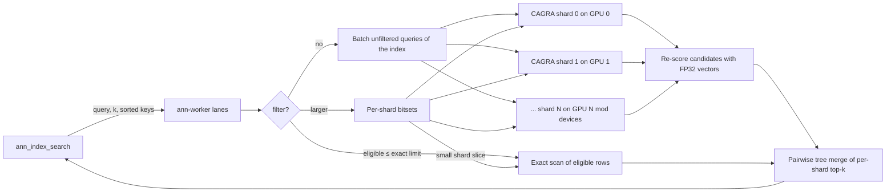

# Loaded cuVS indexes: sharded multi-GPU search from PostgreSQL

An offline Python script builds an immutable, sharded CAGRA index directory from a table. The C worker loads it across all GPUs, and two C SQL functions serve ANN and hybrid (filtered) queries. Everything on the query path is C: the PostgreSQL functions, the worker, and the cuVS adapter. Python is used only by the offline builder, tests and benchmarks.

## Quick start

```sh
# GPU host: build the worker with cuVS (default builds are CPU-only)
make -C ann USE_CUVS=1 CUVS_PREFIX=/path/to/libcuvs CUDA_HOME=/path/to/cuda
ann/ann-worker-cuvs --backend cuvs --listen /tmp/ann.sock --lanes 64

# offline build: one shard per visible GPU, FP16 dataset for bandwidth
python3 scripts/ann/build_cuvs_index.py --dsn 'dbname=app' --table public.docs \
    --key id --vector embedding --out /data/ann/docs --dtype float16
```

```sql
-- postgresql.conf: ann.worker_socket = '/tmp/ann.sock'
SELECT ann_index_load('docs', '/data/ann/docs');          -- superuser; returns rows loaded

-- ANN
SELECT d.* FROM ann_index_search('docs', $1, 10) s JOIN docs d USING (id) ORDER BY s.distance;

-- hybrid: any SQL predicate selects the eligible keys
SELECT d.* FROM ann_index_search('docs', $1, 10,
    ARRAY(SELECT id FROM docs WHERE tenant = $2 AND body @@ to_tsquery('english', $3))) s
JOIN docs d USING (id) ORDER BY s.distance;
```

`ann_index_search(name, query, k, filter bigint[] DEFAULT NULL)` returns up to `k` rows of `(id bigint, distance real)`, sorted by L2 distance. Distances are exact (FP32 vectors re-score every candidate), so they agree with `<->`. A NULL filter means no filter; an empty array, or one whose keys are all absent from the index, returns no rows. NULL elements are ignored.

## On-disk format

| File | Content |
| --- | --- |
| `manifest` | Text `key value` lines: `pgvector-ann-index 1`, `dimensions`, `rows`, `metric l2`, `dtype float32\|float16`, `source schema.table`, `shards N`, then `shard i first rows file` per shard. Written last, so partial builds are never loadable. |
| `keys.i64` | `rows` strictly increasing little-endian int64 table keys. Global ordinal *i* is the *i*-th smallest key. |
| `vectors.f32` | `rows × dimensions` little-endian FP32 vectors in key order. They're memory-mapped for the exact route and for re-scoring. |
| `shard-i.cagra` | CAGRA graph and dataset (`cagra.save(..., include_dataset=True)`) for ordinals `[first, first + rows)`. |

Shards are contiguous key ranges, so mapping a key to its shard is a binary search, and shard results never overlap. The worker validates the manifest, file sizes, key order, and each shard's dimensions and row count before registering the index.

**Immutability.** A directory is never modified, and the builder refuses a non-empty output directory. `ann_index_load` compares the source table's current row count with the manifest and refuses a stale index. After a table changes, build a new directory and load it under a new name. Joining results back to the table drops deleted keys, but rows added after the build are invisible. A loaded name stays until the worker restarts.

## Search execution



- **Lanes and devices.** A lane is a worker thread with its own cuVS resources, stream, workspace pool and buffers on every GPU. Shard *i* lives on GPU *i* mod the device count, or on every GPU with `--replicate on`. Requests from all PostgreSQL connections share one queue and one admission budget (`--max-pending-mb`).
- **Unfiltered batching.** A lane takes up to `--max-batch` queued queries. Unfiltered queries against the same index go to each shard as one query matrix. Each shard is searched asynchronously on its own GPU, then the lane synchronizes every device once.
- **Filtered queries.** The worker maps the eligible keys to ordinals. If the total is at most `--exact-limit` (default 20,000 rows), it scans those rows exactly on the CPU, which is cheaper than a graph search and gives full recall. Otherwise each shard whose slice is at most `exact-limit / shards` is scanned exactly, and the remaining shards run CAGRA with a bitset of their eligible rows. Selective filters (under 25% of rows) raise the CAGRA internal top-k to `--filtered-itopk` (default 512) to keep recall up.
- **Merge.** The worker re-scores each shard's candidates with FP32 vectors, sorts them, and merges the shard lists pairwise, halving their number each round, down to the global top-k.

## B200 throughput options

| Option | Effect |
| --- | --- |
| `--dtype float16` (builder) | Stores the CAGRA dataset in FP16: half the HBM traffic and footprint (8.5 GB vs 11 GB on disk for 10M×128). The worker converts queries to FP16, and FP32 re-scoring keeps returned distances exact. |
| `--itopk N` (worker) | CAGRA internal top-k for unfiltered queries, at most 512. This is the main recall/throughput dial. The default is 128; 64 kept recall@10 at 1.0 on the 10M benchmark below. |
| `--filtered-itopk N` | Internal top-k for selective filters, at most 512 (single-CTA CAGRA search). |
| `--max-batch N`, `--delay-us N` | Queries per CAGRA submission, and an optional wait to fill a batch. |
| `--lanes N` | Concurrent submissions across all GPUs. |
| `--cagra-persistent on` | cuVS persistent search kernels, for many small batches. |
| `--replicate on` (worker) | Loads every shard on every GPU, and each lane searches its home GPU's copy. Combined with `--shards 1` in the builder, a query is a single CAGRA search on one GPU: the highest ANN throughput measured. Use it when one copy of the index fits in one GPU's memory. |
| `--exact-limit ROWS` | Where filtered queries switch from exact scans to filtered CAGRA. |

cuVS 26.10's CAGRA supports FP32, FP16, int8 and uint8 datasets. It has no NVFP4 or FP8 path, so those aren't offered. int8/uint8 need a quantization scale chosen when building the index; that's left for a later builder option.

## Build flag

The extension never links CUDA: it talks to the worker over a Unix socket, so the extension and the CPU worker build anywhere, including hosts without a GPU. `make -C ann USE_CUVS=1` additionally builds `ann-worker-cuvs` against cuVS (`CUVS_PREFIX`, `CUDA_HOME`, plus `CPPFLAGS`/`LDFLAGS` for pip-installed SDKs). Without it, the CPU worker's `cpu-exact` backend serves loaded indexes exactly from `keys.i64` and `vectors.f32`, using the same per-shard tree merge. That makes it the reference for tests.

## Tests

| Test | Needs | Covers |
| --- | --- | --- |
| `test/ann/test_index.py` | CPU worker; `ANN_PG_DSN` for the SQL tests | File format, corrupt files, sharded tree merge against brute force, filters (unknown keys, duplicates), protocol errors. Through SQL: ANN and hybrid results equal to `ORDER BY <->`, joins, empty/NULL filters, unavailable worker, stale-index refusal, superuser-only load. |
| `test/ann/test_cuvs_index.py` | `ANN_CUVS_TEST=1`, GPU, cuVS Python | Builder output for FP32 and FP16; recall ≥ 0.9 for ANN and filtered CAGRA; filtered results stay within the filter; exact route equal to SQL; exact distances. |
| `test/ann/test_cuvs_gathered.py` | `ANN_CUVS_TEST=1`, GPU | GPU brute force for the pipelined CustomScan route. |

```sh
make -C ann check
ANN_PG_DSN='host=/tmp dbname=postgres' python3 test/ann/test_index.py
ANN_CUVS_TEST=1 ANN_PG_DSN='host=/tmp dbname=postgres' python3 test/ann/test_cuvs_index.py
```

## Load test

`benchmarks/ann/cuvs_load.py` generates a synthetic table (`tenant` filters 0.1% of rows, `category` 1%), then sweeps `pgbench` client counts for each workload, reporting QPS, latency percentiles and recall@10 against exact SQL.

### Results on 8× NVIDIA B200

Setup:
- **Host:** 224 CPUs, 2 TB RAM, 8× B200 (driver 580.126), cuVS 26.10, PostgreSQL 17.6. PostgreSQL, `pgbench`, and the worker all ran on the GPU host.
- **Data:** 10,000,000 rows × 128 dimensions of clustered, low-intrinsic-dimension synthetic vectors. Query vectors are drawn from the same distribution but aren't rows of the table.
- **Queries:** k = 10, `pgbench -M prepared`, worker `--lanes 96 --itopk 64`. Recall@10 is measured against exact SQL on 20 sample queries.
- **Filters:** covering `(filter, id)` B-tree indexes produce the eligibility arrays.

Peak throughput by layout:

| Layout | Workload | Recall@10 | Peak QPS (clients) | p50 / p99 at peak |
| --- | --- | --- | --- | --- |
| 8 shards, 1 per GPU, FP32 | ANN | 1.0 | 362,889 (1,536) | 3.4 / 12.3 ms |
| 8 shards, FP16 | ANN | 0.985 | 354,250 (1,024) | 2.4 / 8.4 ms |
| 1 shard replicated to every GPU (`--replicate on`) | ANN | 1.0 | **388,572** (1,536) | 3.0 / 12.9 ms |
| 8 shards | hybrid, 1% filter (100k keys, filtered CAGRA) | 1.0 | 3,592 (256) | 38 / 412 ms |
| 1 shard replicated | hybrid, 1% filter | 0.68 | 7,507 (256) | 29 / 165 ms |
| 8 shards | hybrid, 0.1% filter (10k keys, exact route) | 1.0 | 14,535 (256) | 9.3 / 98 ms |
| 1 shard replicated | hybrid, 0.1% filter | 1.0 | 14,465 (2,048) | 110 / 492 ms |

ANN scaling, 8 shards FP32:

| Clients | 64 | 128 | 256 | 512 | 1,024 | 1,536 | 2,048 |
| --- | --- | --- | --- | --- | --- | --- | --- |
| QPS | 73,152 | 96,107 | 185,933 | 305,658 | 355,550 | 362,889 | 343,608 |
| p99 ms | 1.2 | 2.3 | 2.2 | 3.0 | 8.3 | 12.3 | 16.8 |

What the measurements showed:

- **ANN saturates the host at about 350–390k QPS from 1,024 clients on.** All eight GPUs then report about 99% utilization, and the host CPUs are about 95% busy; the worker accounts for about 150 cores, mostly in kernel time. Per query, the host side (PostgreSQL, the socket round trip, lane wake-ups and device synchronization) costs about as much as the GPU work, so FP16 adds little at this scale.
- **Per-lane cuVS workspace pools were the largest single fix.** Without them, concurrent searches serialize on device allocation: ANN reached 26,891 QPS with a flat 28 ms median.
- **Hybrid throughput is bounded by producing the eligibility array in PostgreSQL.** With a covering index, a 100k-key array costs about 7 ms, roughly 11k arrays per second at best; a 10k-key array costs about 1 ms (about 34k per second). Without the covering index the heap visits dominate: about 3k and 9k arrays per second.
- **Filtered CAGRA recall depends on shard size.** Eight 1.25M-row graphs keep recall@10 at 1.0 with a 1% filter. One 10M-row graph drops to 0.68, because CAGRA's internal top-k is capped at 512. With a single replicated shard, raise `--exact-limit` (exact scans of up to about 100k rows cost a few milliseconds) or keep shards smaller.
- **Synthetic data choice matters.** Isotropic random vectors (uniform, or Gaussian clusters with full-dimensional noise) defeat every graph index: CAGRA reached recall@10 of 0.13 on them even when driven directly from Python. The generator therefore projects 16-dimensional clustered latents to 128 dimensions. Measure your own embeddings before relying on these numbers.

Reproduce:

```sh
python3 benchmarks/ann/cuvs_load.py generate --dsn "$DSN" --table bench10m --rows 10000000 --dimensions 128
python3 scripts/ann/build_cuvs_index.py --dsn "$DSN" --table public.bench10m --vector emb --out /data/bench10m
ann/ann-worker-cuvs --backend cuvs --listen /tmp/ann.sock --lanes 96 --itopk 64
python3 benchmarks/ann/cuvs_load.py bench --dsn "$DSN" --table bench10m --index b32 --path /data/bench10m \
    --socket /tmp/ann.sock --clients 64,256,1024,1536 --threads 96
```

`max_connections` must exceed the largest client count, and the shell running `pgbench` needs enough file descriptors.
