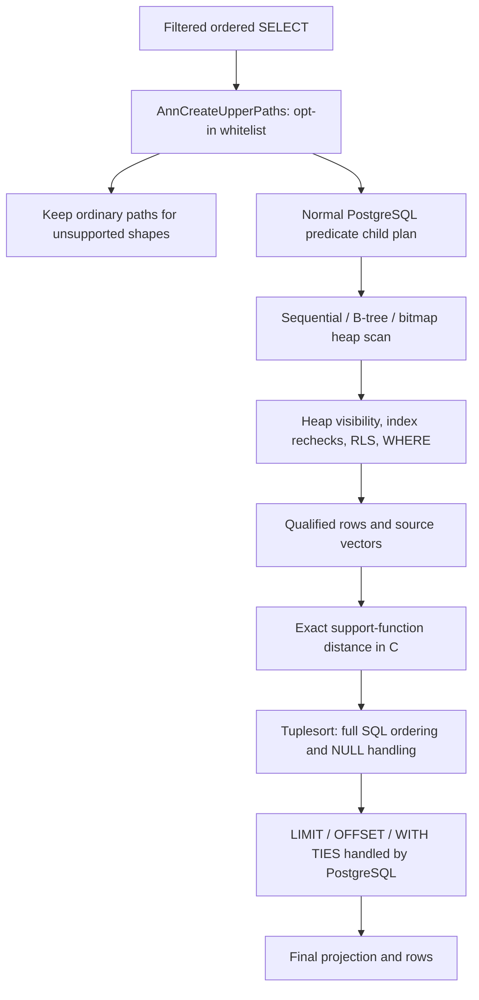

# Native filtered exact search

`AnnFilteredSearch` is an opt-in C CustomScan. It computes exact distances over rows produced by a normal PostgreSQL predicate plan, so a restrictive text/metadata filter can avoid reading and scoring every vector in the `ann` index. The standalone worker and GPU adapters are not involved in this route.

## Enable and inspect

```sql
LOAD 'vector';
SET ann.enable_filtered_search = on;
SET gin_fuzzy_search_limit = 0;

EXPLAIN (ANALYZE, BUFFERS)
SELECT id, embedding <-> '[1,2,3]' AS distance
FROM documents
WHERE tenant = 'example' AND terms @@ to_tsquery('simple', 'database')
ORDER BY distance, id LIMIT 10;
```

The relation must have a valid, non-partial, plain-column `ann` index matching the distance operator's support function. Predicate indexes are optional: PostgreSQL chooses between sequential, B-tree, and bitmap heap scans, including GIN. The custom route reads vectors from the predicate child's visible heap/index tuples, rather than from the `ann` pages. The index currently supplies the supported-column/metric contract.

`LOAD` reliably installs hooks even when no earlier vector input/function call has loaded the extension in that backend. The GUC defaults to off. Changing it affects subsequent planning; already cached prepared plans retain their route until replanned. Deallocate/reprepare or use `DISCARD PLANS` to change those plans.

## Implemented execution



[src/annplan.c](../src/annplan.c) chains the previous upper-path hook and replaces compatible full SortPaths with equivalent CustomPaths. It retains PostgreSQL's predicate path choice, pathkeys, and ordinary predicate/projection/sort cost estimates; there is no fabricated GPU cost discount. Ordered access-method scans, incremental sorts, and other alternatives remain available to the planner.

[src/anncustom.c](../src/anncustom.c) initializes the child through the normal executor. Its plan changes the child's distance-output column into a vector-input column. The custom executor computes that distance after the child has applied all its quals, and sorts output tuples using the original ordering operators, collations, and NULL rules. Query vectors are copied and detoasted into query-owned memory before per-tuple contexts are reset. Moved operator calls retain function EXECUTE checks and PostgreSQL function-access hooks. The output target list remains typed as the original SQL distance expression.

A positive, finite `LIMIT + OFFSET` uses a bounded sort. Bounds come from execution-time Const/external Param values, including generic prepared statements, rather than estimated row counts. NULL/unbounded limits, overflow, and WITH TIES use an unbounded sort; PostgreSQL retains final limit/offset/tie semantics. Sorting respects `work_mem` and spills as needed. The executor checks interrupts while consuming rows and relies on PostgreSQL resource owners and query contexts for error cleanup. Scroll cursors receive core materialization when required.

## Supported initial contract

- Top-level, single ordinary table SELECT, with predicates and a matching unconditional plain-column `ann` index.
- Ascending distance as the first ordering expression, NULLS LAST, with the indexed column on the left and a vector Const/external Param on the right. Secondary ordering keys retain their SQL operators and collations.
- A strict, immutable support function matching the SQL operator. The shipped opclass is fixed-dimension `vector` L2.
- Complete sequential/B-tree/bitmap predicate paths. Accelerator-ordered, index-only, and parameterized/parallel paths are not converted.
- Const/external Param LIMIT/OFFSET, including NULL and generic prepared parameters. WITH TIES retains every peer.

Joins, subquery roots, CTEs, aggregates/grouping, DISTINCT, windows, SRFs, row locks, volatile target/predicate expressions, expression/partial ANN indexes, alternate distance orderings, and complex limit expressions keep ordinary PostgreSQL execution. Enabling the GUC does not force a custom plan when another path wins or this whitelist does not match.

Complete eligibility requires `gin_fuzzy_search_limit = 0`. Planning skips the custom route otherwise. Execution also checks this setting so a cached plan cannot silently change its eligibility contract after a GUC change; such a cached custom plan reports an error until the setting is restored or the query is replanned.

## EXPLAIN and validation

EXPLAIN reports `Search Route: exact CPU after predicates`. ANALYZE also reports total `Eligible Rows`, custom-stage `Distance Evaluations`, and sort method/space. NULL operands skip the distance call. Counts accumulate over executions/rescans of that node; they are not whole-query GPU or IPC metrics.

A local 4,096-row fixture with 40 qualifying rows used a B-tree child scan, evaluated 40 distances, and used a top-N heapsort for LIMIT 10. This checks selective execution; it is not a production throughput measurement or a claimed speedup over PostgreSQL's ordinary filtered exact sort.

[test/ann/test_filtered.py](../test/ann/test_filtered.py) compares this route to ordinary exact SQL and checks that the CustomScan was used. It covers B-tree/GIN predicates, combined filters, projection, spill, ties, NULLs, LIMIT/OFFSET and generic prepared parameters, snapshots/writes, RLS, function EXECUTE permissions, toasted 2,000-dimension vectors, cancellation cleanup, fuzzy-GIN cached-plan checks, index-only fallback, and unsupported-shape fallback. [The SQL regression](../test/sql/ann_filtered.sql) adds prepared queries and scroll-cursor behavior to the normal pgvector harness.

```sh
make && make install
make installcheck
ANN_PG_DSN='dbname=test_database' make -C ann check-postgres
```

Runtime code remains C; Python drives tests and benchmarks only. Local testing uses PostgreSQL 17.6/macOS ARM64; the full PostgreSQL CI matrix is still required. Native worker IPC, pre-eligibility admission, process-wide batching, accelerator mappings/generations, and sustained-load validation are next milestones. CAGRA integration and compilation against cuVS remain deferred.

The SQL benchmark generator can include this route alongside the existing exact and HNSW baselines:

```sh
python3 benchmarks/ann/postgres.py --rows 10000 --dimensions 32 --filtered-native > /tmp/ann-benchmark.sql
psql -X -v ON_ERROR_STOP=1 -f /tmp/ann-benchmark.sql test_database
```

It uses a temporary relation and rolls back. Inspect each EXPLAIN: enabling the route does not guarantee that the planner selects it when ordered/index-only alternatives are available.
