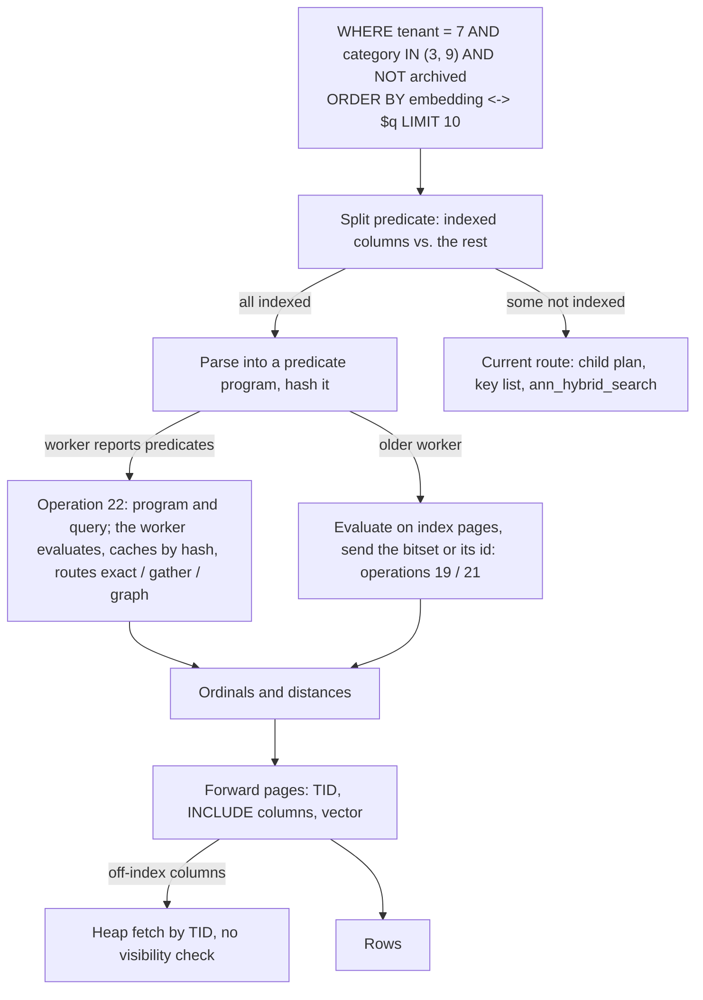

# Immutable forward and inverted indexes with GPU ANN: plan

Status: proposed. Everything it builds on is implemented: the `ann` access method ([guide](ann-native-index.md)), the filtered CustomScan ([guide](ann-filtered-search.md)), loaded cuVS indexes and hybrid search ([guide](ann-cuvs-index.md)), filters resolved on the GPU node with attribute columns, cached bitmaps and same-filter grouping ([guide](ann-gpu-filters.md)), and the networked GPU nodes ([guide](ann-networked.md)). Generations and the mutable delta are specified in [section 8 of the cuVS plan](cuvs-filtered-ann-plan.md#8-identity-mvcc-and-mutable-operation) and are referenced, not rewritten, here.

## 1. Objective

Answer `WHERE <predicate over indexed columns> ORDER BY embedding <-> $q LIMIT k` with three indexes that share one row numbering:

| Index | Holds | Today | Planned |
| --- | --- | --- | --- |
| Forward (ordinal → data) | heap TID, vector, attribute columns | worker files `keys.i64`, `vectors.f32`, `attr-COLUMN.i32`; PostgreSQL has only the heap | index relation pages addressed by ordinal; the worker files become an export of those pages |
| Inverted (value → ordinals) | per-value posting lists and bitsets, cached filter bitmaps | built on the worker at load; filter bitmaps built by a SQL `SELECT id WHERE …` over the heap | posting and bitset pages in the index relation; a shared C evaluator for `=`, `IN`, ranges, `NOT`, `AND`, `OR` on both sides |
| ANN | CAGRA shards, quantized copies, gather and grouped scans | loaded from the builder's directory | unchanged; it receives the bitset or its id as it does now |

Both sides must agree bit-for-bit on which ordinal a row has, because a bitset built from PostgreSQL pages is the filter mask the GPU applies. That agreement is the first constraint below; the rest follows from it.

Runtime code stays C. Python remains in the offline CAGRA build and in tests. Linux and macOS only.

## 2. One ordinal space

**Decision: ordinal = rank of the key in ascending key order.** This is already the worker's numbering (`keys.i64` is sorted, the builder reads `ORDER BY key`), so nothing changes on the GPU side. The AM build adopts it: the table-AM scan feeds a tuplesort on the key column, and pages are written from the sorted stream. Heap block order is not used, because PostgreSQL's scan order is a physical accident that a rewrite or a different `fillfactor` would change, while the key order is a property of the data.

The index needs a key column: the first `INCLUDE` column of an integer type, or the `key` reloption naming one. Duplicate or NULL keys fail the build; the cuVS builder already requires the same.

**Verification.** The build computes a generation id: `hash_bytes_extended` over `(row count, dimensions, xor-fold of all keys, key column name)`, stored in the metapage and written by the exporter into the manifest as `generation`. Operation 15 (index info) reports it; `ann_index_load` resolves the source table through `ann_index_catalog.source`, finds its frozen `ann` index, and refuses a directory whose generation differs from that relation's (today it compares only the row count). Every cached bitmap id becomes `hash(index name, generation, filter text)`, so a rebuilt table invalidates every cache entry without a push. Requests tagged with a generation the worker doesn't serve get a new status, `ANN_GENERATION` (12).

## 3. Freeze contract

The immutable base is declared, not inferred:

```sql
CREATE INDEX docs_ann ON docs USING ann (embedding vector_l2_ops)
    INCLUDE (id, tenant, category)
    WITH (frozen = true, key = 'id');
```

- **Build time.** Under the `ShareLock` the build already holds, check that every heap page has the all-frozen bit in the visibility map (`visibilitymap_count` equals the relation's page count). Otherwise fail with a hint to `VACUUM (FREEZE)` first. Rows not frozen can still have invisible versions, which would break "every ordinal is live".
- **After the build.** `aminsert` raises `immutable index "docs_ann": load a new generation` and `ambulkdelete` returns without touching pages. Since DELETE, TRUNCATE and HOT updates bypass the AM, `ann_freeze(regclass)` also installs a `BEFORE INSERT OR UPDATE OR DELETE OR TRUNCATE` guard trigger on the table; the build refuses `frozen = true` on a table without the guard. The guard is an ordinary trigger a superuser can drop, which is the documented way to retire a generation.
- **What the contract buys.** No visibility checks on scans (every TID in the forward array is live), `amcanreturn` for the vector and `INCLUDE` columns, and snapshot validity collapsing to `(generation, predicate)`, which satisfies the cache-validity condition in the cuVS plan's section 5 that a filter text alone could not.
- **New rows.** They go to a hot partition or delta table with an HNSW index; a query unions the frozen generation and the delta and takes the top k of both (the cuVS plan's "immutable base plus durable delta"). Folding the delta into a new generation is a rebuild: new ordinal space, new export, new load under a new name, `ann_index_catalog` switched atomically. This plan does not change that design; it only makes the base's structures explicit.

## 4. SQL surface and planner contract

The CustomScan in [src/annplan.c](../src/annplan.c) and [src/anncustom.c](../src/anncustom.c) gains a third route beside "exact CPU after predicates" and the worker pipeline:



On the default path PostgreSQL only parses the predicate into a program and never touches bitset pages; the worker evaluates and routes it exactly as it does for a cached bitmap today, so the per-query CPU work on the PostgreSQL side stays at parsing plus the forward lookups of k hits. PostgreSQL evaluates from pages only for `ann_filter_bitmap_build`, for a worker without predicate support, and in the bitset-identity tests. The route finds the worker-side index name through `ann_index_catalog.source`, the row whose source is the scanned table and whose generation matches the index relation's.

**Predicates evaluated from pages:** `=`, `<>`, `IN`, `<`, `<=`, `>`, `>=`, `BETWEEN`, `IS NULL`, `NOT`, `AND`, `OR` over `INCLUDE` columns of `int2`, `int4`, `int8`, `bool`, `date`, and `text`/`enum` with at most 2^31 distinct values (dictionary-coded, see section 5). A predicate with any other column or operator takes today's route unchanged; a later step can intersect the two (evaluate the indexed part to a bitset, AND it with the child plan's key list).

**Projection.** `id`, the `INCLUDE` columns, the vector and the distance come from index pages; only other columns fetch the heap through the forward TID array. EXPLAIN reports `Search Route: frozen index predicates`, `Filter Rows` (popcount), `Heap Fetches`.

**Stored filters.** `ann_filter_bitmap_build(name, filter)` keeps its signature and result but evaluates the filter text through the same parser when it can, writing the bitset from pages instead of running SQL over the heap. Filters it cannot parse still run as SQL. `ann_bitmap_search` and `ann_attribute_search` keep working; they become thin cases of the general route.

## 5. Page layouts

All pages are standard PostgreSQL pages with the `ann` special space; payload is 8,160 bytes. The metapage gains a directory of page ranges per structure, the generation id, row count and the `INCLUDE` column list. Ordinal arithmetic replaces trees everywhere:

| Structure | Element | Per page | 10M rows | Address of ordinal *i* |
| --- | --- | --- | --- | --- |
| Forward TIDs | 6-byte `ItemPointerData` | 1,360 | 7,353 pages (57 MB) | block `first + i / 1360`, slot `i % 1360` |
| Keys | int64 | 1,020 | 9,804 pages | same form; key → ordinal is a binary search over pages (about 14 page reads) |
| Vectors | FP32 × dims, fixed stride | `8160 / (4·dims)` (15 for 128) | 667k pages (5.1 GB) | block `first + i / perPage` |
| Attribute column *c* | int32 code | 2,040 | 4,902 pages (38 MB) | block `first_c + i / 2040` |
| Dictionary of *c* | sorted distinct values (int64 or text) | varies | one page for 1,000 categories | binary search; a range predicate becomes a code range |
| Postings of *c* | per code: offset, count; then uint32 ordinals | 2,040 ordinals | 4,902 pages total (every row appears once per column) | directory page, then `offset / 2040` |
| Bitset per code (codes with ≥ `bitset_min` rows) and per stored filter | bits | 65,280 | 154 pages (1.25 MB) each | block `first + i / 65280`, word `(i % 65280) / 32`, bit `i % 32` |

The vector pages replace today's index tuples with a fixed stride, so a candidate's exact distance is one buffer read without `IndexTupleSize` walking; the quantized NVFP4/FP8 copies stay in the worker's files. All pages are written once by the build through the existing generic-WAL build path in [src/annbuild.c](../src/annbuild.c) and never changed afterwards.

**Export.** `ann_index_export(index regclass, path text)` writes `manifest`, `keys.i64`, `vectors.f32`, `attr-COLUMN.i32` and the dictionaries from these pages; `scripts/ann/build_cuvs_index.py --from-export PATH` builds only the CAGRA shards and quantized copies from them. The exported files are byte-identical in meaning to the ones the builder writes today from SQL, so existing directories keep loading; the export is the way to guarantee the ordinal space is the index relation's.

## 6. Shared predicate evaluator

One C file, `ann/filter.c`, compiled into both the extension and the worker, with no PostgreSQL headers: it takes a postfix program (`PUSH code-list`, `PUSH range`, `PUSH bitmap-id`, `AND`, `OR`, `NOT`) and callbacks that give it, for a column and code, either a sorted ordinal list or a bitset. It chooses the representation per node: merge-intersection while both operands are lists shorter than `N / 64`, bitset words otherwise; `NOT` and `OR` of a list materialize a bitset. Its output is a bitset plus popcount.

PostgreSQL's callbacks read the pages in section 5 under shared buffer locks; the worker's read its load-time postings and device bitsets. The wire form of the program is the payload of a new operation 22 (`search by predicate`): `u32 name length, name, u32 dimensions, k, u32 program length, program; FP32 query`, with the generation id in the header's reserved bytes. The worker evaluates, caches the result under the program's hash as an ordinary bitmap entry (so same-predicate grouping and device row lists apply), and searches as for operation 21. The PostgreSQL side can therefore send either the bitset (19), its id (21) or the program (22); the plan's default is 22 when the worker reports `predicates on` in operation 15, else 21 with a push on `ANN_MISSING`.

Because both sides run the same evaluator over the same ordinal space, a test can compare their bitsets word for word.

## 7. Protocol decision: ordinals or keys in replies

Today every search reply carries keys, and PostgreSQL joins them to the heap. With a forward array, ordinals are better: `ordinal → TID` is one page read, while `key → ordinal` costs a binary search over the key pages.

| Option | Change | Cost per hit | Risk |
| --- | --- | --- | --- |
| Keep keys | none | about 14 page reads (binary search over 9,804 key pages, then within one page) | none |
| Ordinals, flagged | one flag bit in operations 12/14/17/19/21/22 requests ordinals; the worker returns the row index instead of `keys[row]` | 1 page probe | callers that join on `id` must not set the flag |

**Recommendation: ordinals behind the flag**, set only by the CustomScan route; the SQL functions `ann_index_search` and friends keep returning `(id, distance)`. The flag defaults off so existing clients and tests see no change.

## 8. Phases and gates

Each phase lands with its tests, pgindent-clean, and is pushed only after the suites pass on the GPU host.

### Phase 1: frozen contract and key order

Files: `src/ann.c` (reloptions `frozen`, `key`; `amcaninclude`, `amcanreturn`), `src/annbuild.c` (tuplesort by key, visibility-map and `relfrozenxid` checks, generation id), `src/anninsert.c`, `src/annvacuum.c` (refusals), `sql/vector--0.9.0--0.9.1.sql` (`ann_freeze`, guard trigger function), `src/ann.h` (metapage directory).

Gates: build on an unfrozen table fails with the hint; INSERT/UPDATE/DELETE/TRUNCATE on a frozen table are rejected; the metapage generation equals the one `scripts/ann/build_cuvs_index.py` writes for the same table (the builder learns to compute it in this phase); existing `test/ann/test_native.py` and the SQL regression still pass for non-frozen indexes.

### Phase 2: forward pages and export

Files: `src/annbuild.c` (TID, key, vector, attribute and dictionary pages), new `src/annpages.c` (read-by-ordinal API: `AnnPagesTid`, `AnnPagesVector`, `AnnPagesCode`, `AnnPagesKeyOrdinal`), `src/annscan.c` (exact scans read fixed-stride vectors), `src/annexport.c` and SQL `ann_index_export`, builder `--from-export`.

Gates: an export equals the builder's SQL-sourced files byte for byte on the test fixtures; `ann_index_load` accepts the export; a frozen index answers `SELECT id, tenant, embedding <-> $q` without heap access (`Heap Fetches: 0`); exact-route results equal SQL on `test/ann/test_filtered.py`.

### Phase 3: inverted pages and the shared evaluator

Files: `src/annbuild.c` (postings, per-code bitsets), new `ann/filter.c`/`filter.h` (evaluator, program encoding), `src/annpred.c` (predicate → program, with the whitelist of columns and operators), `src/anncustom.c` (route, EXPLAIN fields), `src/annindex.c` (`ann_filter_bitmap_build` via pages when parseable, bitmap id with generation), `ann/server.c` and `ann/cuvs.c` (operation 22, `ANN_GENERATION`, the ordinal flag), `ann/indexfile.c` (postings for the evaluator), docs and protocol tables.

Gates: for every predicate shape in the whitelist, PostgreSQL's bitset equals the worker's word for word on the 7-shard CPU fixture and on `bench10m`; results equal exact SQL on every route, as `test_cuvs_index.py` checks today; `ann_filter_bitmap_build` on `bench10m` (10M rows) drops from seconds (heap scan) to a cost proportional to the selected rows: an equality, IN or range comes from prebuilt bitsets or postings (under 1 ms for a 1% filter, a few ms for 10%), an AND of two bitsets is 154 pages of word operations (under 1 ms), and only a column without postings falls back to walking its 4,902 attribute pages (5–20 ms); filtered QPS on one and eight B200s is unchanged within noise, since the GPU routes don't change; grouping statistics show operation-22 searches grouping by program hash.

### Phase 4: delta union and generation switch

Files: `src/annplan.c` (union of frozen base and hot partition under one `ORDER BY … LIMIT`), `src/annremote.c` (generation in request headers, `ANN_GENERATION` retry after reload), docs.

Gates: a query over base plus delta equals exact SQL over the whole table; publishing a new generation leaves no window where a stale bitmap id answers (the id carries the generation); the retired generation's guard trigger drop and `DROP INDEX` reclaim everything.

## 9. What does not change

The CAGRA shards, quantized copies, gather and grouped tensor-core scans, same-filter scheduler, RDMA lanes, heartbeats and the 8-GPU replication all stay as measured in [ann-gpu-filters.md](ann-gpu-filters.md) and [ann-blackwell.md](ann-blackwell.md). This plan moves the filter side onto fixed-shape pages that both PostgreSQL and the worker address by the same integer; it does not touch how the GPU scores rows.
