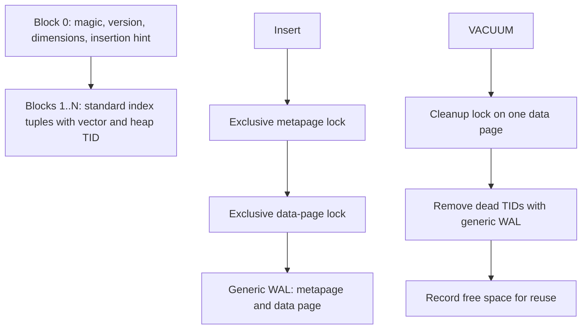

# Native CPU staging index

The experimental `ann` access method is implemented in C inside `vector`, using pgvector's callback and file layout. It provides an exact L2 storage/lifecycle baseline for later accelerator integration. It does not call the standalone worker or GPU libraries. Its scan reads and sorts every index entry before returning results, including for a small LIMIT. It should not be used as a throughput optimization over sequential exact search.

## SQL and installation

Build/install the extension using the repository's normal PGXS commands. Fresh installs use version 0.9.0; existing 0.8.7 installs use `ALTER EXTENSION vector UPDATE TO '0.9.0'` after installing the updated library and SQL files. No standalone worker dependency is introduced.

```sql
CREATE EXTENSION vector;
CREATE TABLE documents (id bigint, tenant text, terms tsvector, embedding vector(3));
CREATE INDEX documents_ann ON documents USING ann (embedding vector_l2_ops);
SELECT id FROM documents
WHERE tenant = 'example' AND terms @@ to_tsquery('simple', 'database')
ORDER BY embedding <-> '[1,2,3]' LIMIT 10;
```

Only fixed-dimension `vector` with L2 is registered, up to 2,000 dimensions. NULL vectors remain in the index and sort last. Zero vectors are valid. PostgreSQL checks heap visibility and evaluates predicates. The planner can choose another path: the cost model charges for a complete index scan and sort. `SET enable_seqscan = off` is useful in tests to exercise this AM; it is not a production tuning recommendation.

## Code structure and naming

| File | Responsibility |
| --- | --- |
| [ann.h](../src/ann.h) | Shared page format, constants, callback declarations |
| [ann.c](../src/ann.c) | Handler, cost estimate, opclass validation, properties |
| [annplan.c](../src/annplan.c) | Opt-in filtered upper-path hook, whitelist, normal predicate/sort costing |
| [anncustom.c](../src/anncustom.c) | Predicate child plan, exact eligible-vector scoring, bounded sort, EXPLAIN |
| [annbuild.c](../src/annbuild.c) | Table-AM build callback, main/init forks, build WAL |
| [anninsert.c](../src/anninsert.c) | Tuple formation, insertion locks, FSM hints, generic WAL |
| [annscan.c](../src/annscan.c) | Ordered heap-TID scan, rescan, spillable tuplesort |
| [annutils.c](../src/annutils.c) | Type/schema resolution, dimension/page validation, metapage creation |
| [annvacuum.c](../src/annvacuum.c) | Dead-TID removal, page reuse, vacuum statistics |

Callbacks use lower-case AM names (`annbuild`, `anngettuple`); shared helpers/types use `Ann` prefixes, constants use `ANN_`, and private helpers follow existing build/scan naming. Sources include `postgres.h` first, use PostgreSQL allocation contexts, buffer locks, interrupts, table-AM scans, and generic WAL. Files have been formatted with PostgreSQL's `pgindent`. The POSIX scheduler's threads remain outside PostgreSQL and never call backend APIs. Python appears only in testing and benchmarking.

## Execution and storage


This diagram describes ordinary AM execution. The opt-in [filtered CustomScan](ann-filtered-search.md) instead uses a PostgreSQL predicate child plan and scores its eligible vectors. Native worker IPC is future work. GIN and B-tree indexes are not automatically intersected with `ann` pages.



The metapage serializes writers and establishes the metapage-before-data lock order. Vacuum only locks data pages and never acquires the metapage. Free-space-map entries are hints: insertion checks real free space under the data-page lock. Build uses `table_index_build_scan`, per-row temporary contexts, and logs the constructed range. Unlogged indexes receive an init fork. Scan distance evaluation uses the opclass support function; sorting uses `work_mem` and can spill. Physical pages left blank by aborted extension are skipped and can be initialized for reuse.

This format is a correctness baseline. It stores full vectors rather than accelerator row mappings or graphs, has no generation/delta protocol, and does not provide shared admission across PostgreSQL processes. Index concurrency is currently limited by the insertion metapage lock.

## Tests and remaining work

- [SQL regression](../test/sql/ann_vector.sql): ordering, filtered LIMIT, NULLs, lateral rescans, updates/deletes, vacuum, reindex, truncate, and invalid dimensions.
- [Native SQL oracle tests](../test/ann/test_native.py): randomized query vectors, restrictive text/metadata predicates, spill-size sorts, NULL ordering, read-own-writes and abort, repeatable-read snapshots, concurrent writers, pre-build HOT chains, concurrent builds, table rewrites, maximum dimensions, free-space reuse, unlogged/temporary indexes. Plans are checked to ensure the AM was exercised.
- [WAL TAP test](../test/t/050_ann_wal.pl): exact primary/replica results through build, mutation/vacuum, crash recovery, concurrent reindex, and truncate.

```sh
make && make install
make installcheck
make prove_installcheck PROVE_TESTS=test/t/050_ann_wal.pl
python3 -m pip install -r test/ann/requirements-postgres.txt
ANN_PG_DSN='dbname=test_database' make -C ann check-postgres
```

Fresh install and 0.8.7-to-0.9.0 upgrade were also checked, including extension schema relocation. Local validation uses PostgreSQL 17.6 on macOS ARM64. The repository's PostgreSQL CI matrix still needs to run; compatibility beyond the tested host is not claimed. Production rollout also needs broader fault, concurrent-vacuum, and sustained-load tests. Selective exact eligibility execution is now implemented in the opt-in CustomScan. The next native milestone is a bounded C worker client/admission path. CAGRA integration and compilation against cuVS remain deferred, as do hipVS and fused NVFP4 adapters.
