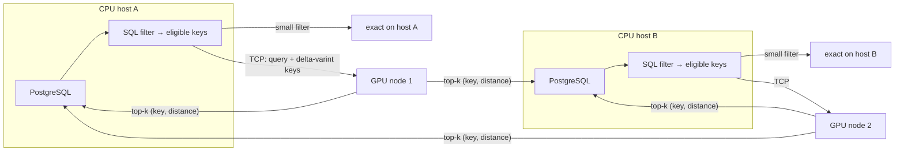

# Networked GPU nodes: hybrid search across PostgreSQL hosts

[Loaded cuVS indexes](ann-cuvs-index.md) can be served by GPU nodes on the network, so many PostgreSQL hosts can evaluate SQL filters on their own CPUs and send only vector search to the GPUs. The query path is C on both sides: `src/annremote.c` and `src/annindex.c` in the extension, `ann/server.c` in the worker.



## Setup

```sh
# GPU node: Unix socket for local tooling, TCP for PostgreSQL hosts
head -c 32 /dev/urandom | base64 > /etc/ann/token && chmod 600 /etc/ann/token
ann/ann-worker-cuvs --backend cuvs --listen /run/ann.sock \
    --listen-tcp 0.0.0.0:7700 --auth-token-file /etc/ann/token --lanes 96 --itopk 64
```

```sql
-- every PostgreSQL host (superuser settings)
ALTER SYSTEM SET ann.worker_address = 'gpu1:7700,gpu2:7700';
ALTER SYSTEM SET ann.worker_auth_token = '...';     -- same token as the nodes
SELECT pg_reload_conf();

-- one host loads the index on every node; the other hosts attach
SELECT ann_index_load('docs', '/data/ann/docs');     -- path on the GPU nodes
SELECT ann_index_attach('docs');                     -- verifies this host's table, records it
```

`ann_index_load` sends the load to every listed node and records the index in `ann_index_catalog` (the source table plus key and vector columns, taken from the manifest). `ann_index_attach` asks a node for the same information, checks this host's copy of the source table against the index's row count, and records it. On physical replicas the catalog arrives through replication.

## Queries and routing

```sql
-- the host evaluates the filter, then routes by its size
SELECT * FROM ann_hybrid_search('docs', $1, 10, format('tenant = %s AND lang = %L', $2, $3));

-- or pass eligible keys yourself; small key lists are scored on this host too
SELECT * FROM ann_index_search('docs', $1, 10, ARRAY(SELECT id FROM docs WHERE tenant = $2));
```

`ann_hybrid_search` runs the filter once and collects its keys straight from the executor (a `DestReceiver`, so no per-row SPI tuple is built). It then routes by the count, against `ann.gpu_min_eligible` (default 1000):

- **Below the threshold:** the host runs `ORDER BY vector <-> query LIMIT k` itself, so the result is exact and no network is used.
- **At or above it:** the host sends the sorted keys to a GPU node as a zigzag varint first key followed by varint gaps. For dense filters that's one or two bytes per key instead of eight. The node scores only those rows with its [GPU gather scan](ann-cuvs-index.md#search-execution), so the result is exact.

The filter is a SQL boolean expression over the source table. It is prepared as one read-only statement, and anything that parses as more than one statement is rejected. It runs with the caller's privileges, like any dynamic SQL; build it with `format()` so values are quoted.

**Choosing the threshold.** The measurements below show the trade-off. The GPU node's exact scan over memory-mapped vectors is far cheaper per query than PostgreSQL fetching scattered heap rows. Local scoring wins only when CPU hosts are numerous enough, or the eligible rows cheap enough to read (for example, a covering index that includes the vector column), to outrun the GPU node's own CPUs.

## Failures and heartbeats

| Mechanism | Behavior |
| --- | --- |
| Node selection | Each backend picks a node by process ID, which spreads backends across nodes, and keeps that connection. |
| Failover | A failed request or connection marks the node down and retries once on the next node. Searches are idempotent. |
| `ann.worker_retry_ms` (10 s) | How long a down node is skipped; it is tried again only after this, or when every node is down. |
| `ann.worker_heartbeat_ms` (5 s) | A connection idle this long is probed (operation 5) before reuse, so a node that died while idle costs one short probe instead of a request timeout. The same value sets TCP keepalive timing on the client. |
| `ann.worker_timeout_ms` (30 s) | Upper bound on any request. |
| Worker keepalive | The worker enables TCP keepalive (10 s idle, 3 probes) on network connections, so readers belonging to PostgreSQL hosts that crashed or were partitioned are released. |
| Auth deadline | An unauthenticated connection must send the token within 10 s, or it is closed. |
| Cancellation | Waits service interrupts; a cancelled request leaves the connection to be reopened rather than reused mid-reply. |

## Security

Network clients must send the shared token (operation 13) before any other frame; any other first frame closes the connection, and the comparison is constant-time. Shared-memory operations (9 and 10) are refused over TCP. `ann.worker_address` and `ann.worker_auth_token` are superuser settings, and the token is hidden from non-superusers. The transport is not encrypted: run it on a private network or VPN, and treat the token as a credential.

## Protocol additions

| Operation | Payload | Reply |
| --- | --- | --- |
| 13 auth | Token bytes | Empty |
| 14 packed index search | u32 name length, name, u32 dimensions, k, key count (UINT32_MAX = no filter), u32 packed bytes; FP32 query; varint keys | As operation 12 |
| 15 index info | Index name | Same text as operation 11, including `key` and `vector` columns |
| 16 RDMA hello | The client's 32-byte queue pair address | u32 largest RDMA frame, the worker's 32-byte queue pair address for this client, device name |

## Measured scaling

One DGX B200 host (224 CPUs, 8× B200) was partitioned to stand in for separate machines:

- **GPU node:** cores 0–95, running the networked cuVS worker.
- **CPU host A:** cores 96–159.
- **CPU host B:** cores 160–223.

Each CPU host ran its own PostgreSQL 17.6 cluster and `pgbench`, and they connected to the worker over TCP on loopback. The setup otherwise matches the [single-host benchmark](ann-cuvs-index.md#results-on-8-nvidia-b200): 10M × 128 dimensions, 8 FP32 shards, `--itopk 64`, recall@10 = 1.0 on every workload. QPS figures are the best of 256 or 512 clients per host.

| Workload | Host A alone | Hosts A + B (total) | Bottleneck |
| --- | --- | --- | --- |
| ANN | 295,787 | 391,781 | GPU node (as on one host) |
| `ann_hybrid_search`, 1% filter (GPU, filtered CAGRA) | 1,203 | 1,298 | GPU node |
| `ann_hybrid_search`, 0.1% filter, GPU route (`gpu_min_eligible = 0`) | 13,895 | 14,320 | GPU node's CPUs (exact scan) |
| `ann_hybrid_search`, 0.1% filter, local route | 3,345 | 5,605 | CPU hosts: scales with hosts |

- A single 64-core CPU host already drives the GPU node to about 300k ANN QPS. Adding hosts helps until the node saturates, at the same ~390k ceiling measured when everything shared one machine.
- Scoring on the CPU hosts is the part that scales with more hosts, but it costs about 4× more per query than the GPU node's exact route on this schema. That's why the default `ann.gpu_min_eligible` is 1000.
- **Full-shard brute force didn't help; the gather scan replaced it.** Masked brute force over each shard (`--filtered-bruteforce`, now removed) scored every row of the shard and reached about 800 QPS on the 1% filter. The gather scan scores only the eligible rows; see below.
- **Larger-scale caveats.** These hosts shared one machine's memory system and talked over loopback. A real network adds round-trip latency (about 10–50 µs in a data center) and per-query bandwidth (about 150 KB for a 1% filter on 10M keys).

### Many PostgreSQL hosts sharing one GPU

The topology this targets is many PostgreSQL hosts, each holding the full table with its own indexes for filters, sharing one GPU node for vector scoring. Adding hosts should add throughput until the GPU node saturates, so the node's cost per filtered query has to be small. Measured on the same machine with an unsharded 10M-row index (`bench10m-1shard`) and a worker on a single B200 with 28 cores (`--lanes 32 --itopk 64`).

The worker alone, driven over TCP by a C load generator (`k = 10`; recall against an exact CPU worker):

| Filter | Filtered CAGRA | Gather scan |
| --- | --- | --- |
| 1% (100k keys) | 4.7k QPS, recall@10 0.66 | 34k QPS, recall@10 1.0, 0.87 ms unloaded |
| 10% (1M keys) | 1.5k QPS, recall@10 0.97 | 3.4k QPS, recall@10 1.0 |
| 0.1% (10k keys) | 14k QPS (CPU exact route) | 72–95k QPS, recall@10 1.0 |

Three changes got there:

1. **The gather scan.** It replaced filtered CAGRA, which spent about 6 ms of GPU time per 1% query on a mostly masked graph walk with internal top-k 512.
2. **Keys mapped to rows on the GPU.** This moved the per-key binary searches off the worker's CPUs.
3. **Huge-page host copies of keys and vectors,** which cut TLB misses on the CPU routes and on FP32 re-scoring.

End to end with `ann_hybrid_search`, each PostgreSQL host on its own 64 cores, both sharing that one-GPU worker (best of 128 or 256 clients):

| Workload | Host A alone | Hosts A + B (total) | Before: A alone / A + B |
| --- | --- | --- | --- |
| 1% filter | 6,832 | 10,883 | 3,977 / 5,916 |
| 0.1% filter, GPU route (`gpu_min_eligible = 0`) | 31,684 | 56,110 | 23,792 / 40,107 |
| ANN | 302,529 | 384,041 | GPU worker (28 cores) saturates |

The "before" column is the previous extension, against the same gather-scan worker.

- **Filtered throughput now scales with PostgreSQL hosts.** The GPU worker serves about 34k 1% queries per second, while one 64-core host produces about 7k.
- **PostgreSQL's key scan is now the cost.** An index-only scan of 100k keys takes about 11 ms, about 100 ns per row. Running the filter once instead of counting first, and collecting keys without SPI tuples, cut a host's CPU per 1% query from about 16 ms to about 10 ms. Beyond that, keys need a cheaper source than an executor scan, such as cached per-value posting lists.
- **Remaining worker cost is host-side.** For a 1% query that's about 0.26 ms decoding 100k varint keys in the connection reader, and about 0.8 ms of lane time issuing copies and kernels and waiting for the device. Batching several filtered queries into one launch is the next step there.

## RDMA (InfiniBand, RoCE)

Search frames can bypass the kernel network stack over RDMA. The transport uses InfiniBand verbs from rdma-core directly, so it runs on any InfiniBand or RoCE adapter (tested with ConnectX-7):

- **Connection setup:** each PostgreSQL backend keeps its TCP connection for authentication, heartbeats, loads, and frames too large for RDMA. After authenticating, it sends its queue pair address (LID, queue pair number, starting packet sequence number, GID) in operation 16. The worker connects a reliable-connected queue pair back and replies with its own address. No IP-over-InfiniBand addresses are needed. RoCE ports route by GID.
- **Data path:** each request is one RDMA send of up to 256 KB, enough for packed filters of about 100k keys. Replies go back on the client's queue pair.
- **Lanes:** `--rdma-lanes N` gives the worker N progress threads. Each has its own completion queue, shared receive queue (256 buffers) and send buffers (256), and clients are spread across lanes at hello. A lane decodes and queues the requests it receives, so ingress scales with lanes. All buffers are registered once at startup.
- **Completions:** worker lanes busy-poll their completion queues from user space; `--rdma-poll wait` sleeps on a completion channel instead, at the cost of an interrupt per wakeup. A backend busy-polls for at most `ann.worker_rdma_spin_us` (default 50 µs), then arms its queue and sleeps in `poll()` on the completion channel and its TCP socket. Hundreds of waiting backends therefore don't each hold a spinning core.
- **Back-pressure:** sending a reply never blocks. If the client's lane has no free send buffer, the reply goes over TCP, which the backend watches while it waits, and the worker counts it in `rdma_fallbacks`.
- **Security:** the worker accepts RDMA frames only on queue pairs it connected for authenticated TCP connections. A queue pair is destroyed when its connection's last in-flight reply is done.
- **Fallback:** frames that don't fit go over TCP. If the device can't be opened, the backend stays on TCP and logs at DEBUG1.

```sh
# GPU node (an active port; check with ibv_devinfo)
make -C ann USE_CUVS=1 USE_RDMA=1 CUVS_PREFIX=...
ann/ann-worker-cuvs --backend cuvs --listen /run/ann.sock --listen-tcp 0.0.0.0:7700 \
    --auth-token-file /etc/ann/token --rdma mlx5_0:1 --rdma-lanes 16 [--rdma-poll spin|wait]

# PostgreSQL hosts
make USE_RDMA=1 && make install USE_RDMA=1
```

```sql
ALTER SYSTEM SET ann.worker_rdma = 'mlx5_0';   -- local device[:port], empty for TCP only
SELECT pg_reload_conf();
```

The worker's statistics (operation 8) report `rdma_frames`, `rdma_fallbacks`, and `rdma_lanes`, next to `jobs` and `batches` for GPU batch occupancy. Each backend uses one queue pair, and a worker accepts up to 32,768.

**Measured.**

Setup:
- **Hardware:** one host with 8× B200 and a ConnectX-7 InfiniBand port (`mlx5_0`); client and worker share the HCA, so the traffic never crosses a switch.
- **Data:** 10M × 128 dimensions, 8 FP32 shards, `--lanes 96 --itopk 64`.
- **Worker:** cores 0–95.
- **PostgreSQL cluster and `pgbench`:** cores 96–159.
- **Runs:** 12 s per cell.

Jobs per batch is the GPU batching occupancy, computed from the worker's statistics.

| Transport | ANN QPS at 64 / 256 / 1,024 clients | Jobs per batch at 1,024 | 1% hybrid QPS at 256 / 1,024 |
| --- | --- | --- | --- |
| TCP | 73,028 / 174,701 / 318,675 | 4.85 | 5,538 / 5,381 |
| RDMA, 1 lane | 67,709 / 90,122 / 95,092 | 1.06 | 3,663 / 3,839 |
| RDMA, 4 lanes | 71,465 / 115,099 / 159,464 | 1.97 | 6,206 / 5,830 |
| RDMA, 8 lanes | 72,177 / 137,738 / 223,263 | 3.03 | 6,225 / 5,959 |
| RDMA, 16 lanes | — / 124,569 / 234,473 | 3.49 | 5,549 / 5,556 |
| RDMA, 32 lanes | — / 119,576 / 227,318 | 4.16 | 5,162 / 5,184 |

Repeated runs varied by about ±10% (16 lanes: 224k and 234k at 1,024 clients).

What the measurements show:

- **The stall is gone.** Before lanes and non-blocking sends, RDMA collapsed above 64 clients (ANN 14,549 QPS at 256 and 21,891 at 1,024) and left about 536 MB of admitted work stuck in the worker. Now every cell ends with nothing pending and nothing rejected. With one lane at 1,024 clients, about 56,000 replies took the TCP fallback; with four or more lanes, none did.
- **Lanes scale ingress up to about 16.** One lane handles every receive, decode and buffer recycle, and saturates near 95k QPS.
- **TCP still leads for unfiltered ANN at high concurrency.** At 1,024 clients, 16 lanes reach about 73% of TCP. Its reader threads (one per connection) decode requests on ~1,000 threads, against 16 lanes. RDMA requests also arrive less clustered, so GPU batches are smaller (3.5 against 4.85 jobs).
- **RDMA wins where frames are large and concurrency moderate.** For the 1% hybrid filter (about 100k packed keys per request), 4–8 lanes beat TCP by 3–12% at 128–256 clients across runs. At 64 clients both transports tie.
- **These numbers don't include a network.** Client and worker share one host and one HCA, so TCP pays only loopback costs. Across a real network, TCP adds a kernel round trip and interrupts on both hosts, which this setup can't show. Measure on two hosts before choosing a transport.

**Limits.**
- Worker lanes spin by default, one core each. Use `--rdma-poll wait` when cores are scarce.
- AWS EFA isn't supported: it needs the SRD transport through libfabric or `efadv`, not reliable-connected queue pairs.
- The test host's IP-over-InfiniBand interfaces have no addresses, so libfabric's `verbs;ofi_rxm` provider can't be used there. Native verbs addressing by LID works without them.

## Tests

`test/ann/test_remote.py` needs `ANN_PG_DSN`; it starts local networked workers. With `ANN_TEST_RDMA=mlx5_0` (an active port, and both builds made with `USE_RDMA=1`), every test runs with search frames over RDMA, and an extra test checks that the worker received them as RDMA frames. It covers:

- Token authentication and unauthenticated disconnects, and refusal of shared memory over TCP.
- Packed-filter decoding, including malformed gaps.
- ANN over TCP.
- Both routes of `ann_hybrid_search` and of the key-array filter, each equal to exact SQL.
- Read-only filter enforcement, attach and catalog, a wrong token.
- Failover with heartbeats after a node dies while idle, and every node down.

### Unattended runs on a GPU node

`scripts/ann/gpu_handoff.sh` builds and checks the networked stack on a GPU node without a session attached:

- It builds the cuVS and RDMA worker and the RDMA extension from a fresh clone.
- It runs every test alone, in its own process group, with a hard time limit, so a hang is reported rather than blocking the run.
- It can wait for other GPU workloads (`ANN_HANDOFF_WAIT_PORTS`) to stop, then runs the cuVS suites and benchmarks TCP, RDMA with spin polling, and RDMA with interrupts.
- It writes a report with per-step results.

Paths, cores and devices are set through `ANN_HANDOFF_*` variables, listed at the top of the script.

```sh
ANN_HANDOFF_WAIT_PORTS="7710 7711" setsid nohup scripts/ann/gpu_handoff.sh >/dev/null 2>&1 < /dev/null &
```
