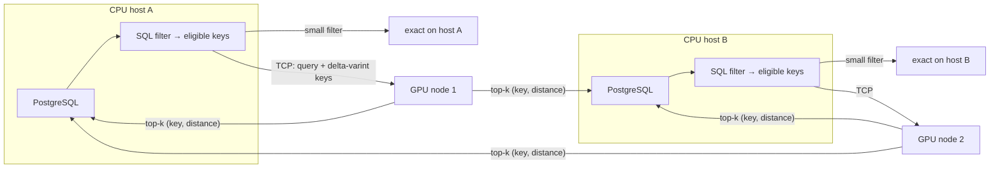

# Networked GPU nodes: hybrid search across PostgreSQL hosts

[Loaded cuVS indexes](ann-cuvs-index.md) can be served by GPU nodes on the network, so many PostgreSQL hosts can evaluate SQL filters on their own CPUs and send only vector search to the GPUs. The query path is C on both sides: `src/annremote.c` and `src/annindex.c` in the extension, `ann/server.c` in the worker.



## Setup

```sh
# GPU node: Unix socket for local tooling, TCP for PostgreSQL hosts
head -c 32 /dev/urandom | base64 > /etc/ann/token && chmod 600 /etc/ann/token
ann/ann-worker-cuvs --backend cuvs --listen /run/ann.sock \
    --listen-tcp 0.0.0.0:7700 --auth-token-file /etc/ann/token --lanes 96 --itopk 64
```

```sql
-- every PostgreSQL host (superuser settings)
ALTER SYSTEM SET ann.worker_address = 'gpu1:7700,gpu2:7700';
ALTER SYSTEM SET ann.worker_auth_token = '...';     -- same token as the nodes
SELECT pg_reload_conf();

-- one host loads the index on every node; the other hosts attach
SELECT ann_index_load('docs', '/data/ann/docs');     -- path on the GPU nodes
SELECT ann_index_attach('docs');                     -- verifies this host's table, records it
```

`ann_index_load` sends the load to every listed node and records the index in `ann_index_catalog` (the source table plus key and vector columns, taken from the manifest). `ann_index_attach` asks a node for the same information, checks this host's copy of the source table against the index's row count, and records it. On physical replicas the catalog arrives through replication.

## Queries and routing

```sql
-- the host evaluates the filter, then routes by its size
SELECT * FROM ann_hybrid_search('docs', $1, 10, format('tenant = %s AND lang = %L', $2, $3));

-- or pass eligible keys yourself; small key lists are scored on this host too
SELECT * FROM ann_index_search('docs', $1, 10, ARRAY(SELECT id FROM docs WHERE tenant = $2));
```

`ann_hybrid_search` counts the filter's rows with a scan capped at `ann.gpu_min_eligible` (default 1000):

- **Below the threshold:** the host runs `ORDER BY vector <-> query LIMIT k` itself, so the result is exact and no network is used.
- **At or above it:** the host streams the matching keys and sends them to a GPU node as a zigzag varint first key followed by varint gaps. For dense filters that's one or two bytes per key instead of eight.

The filter is a SQL boolean expression over the source table. It is prepared as one read-only statement and runs with the caller's privileges, like any dynamic SQL; build it with `format()` so values are quoted.

**Choosing the threshold.** The measurements below show the trade-off. The GPU node's exact scan over memory-mapped vectors is far cheaper per query than PostgreSQL fetching scattered heap rows. Local scoring wins only when CPU hosts are numerous enough, or the eligible rows cheap enough to read (for example, a covering index that includes the vector column), to outrun the GPU node's own CPUs.

## Failures and heartbeats

| Mechanism | Behavior |
| --- | --- |
| Node selection | Each backend picks a node by process ID, which spreads backends across nodes, and keeps that connection. |
| Failover | A failed request or connection marks the node down and retries once on the next node. Searches are idempotent. |
| `ann.worker_retry_ms` (10 s) | How long a down node is skipped; it is tried again only after this, or when every node is down. |
| `ann.worker_heartbeat_ms` (5 s) | A connection idle this long is probed (operation 5) before reuse, so a node that died while idle costs one short probe instead of a request timeout. The same value sets TCP keepalive timing on the client. |
| `ann.worker_timeout_ms` (30 s) | Upper bound on any request. |
| Worker keepalive | The worker enables TCP keepalive (10 s idle, 3 probes) on network connections, so readers belonging to PostgreSQL hosts that crashed or were partitioned are released. |
| Auth deadline | An unauthenticated connection must send the token within 10 s, or it is closed. |
| Cancellation | Waits service interrupts; a cancelled request leaves the connection to be reopened rather than reused mid-reply. |

## Security

Network clients must send the shared token (operation 13) before any other frame; any other first frame closes the connection, and the comparison is constant-time. Shared-memory operations (9 and 10) are refused over TCP. `ann.worker_address` and `ann.worker_auth_token` are superuser settings, and the token is hidden from non-superusers. The transport is not encrypted: run it on a private network or VPN, and treat the token as a credential.

## Protocol additions

| Operation | Payload | Reply |
| --- | --- | --- |
| 13 auth | Token bytes | Empty |
| 14 packed index search | u32 name length, name, u32 dimensions, k, key count (UINT32_MAX = no filter), u32 packed bytes; FP32 query; varint keys | As operation 12 |
| 15 index info | Index name | Same text as operation 11, including `key` and `vector` columns |

## Measured scaling

One DGX B200 host (224 CPUs, 8× B200) was partitioned to stand in for separate machines:

- **GPU node:** cores 0–95, running the networked cuVS worker.
- **CPU host A:** cores 96–159.
- **CPU host B:** cores 160–223.

Each CPU host ran its own PostgreSQL 17.6 cluster and `pgbench`, and they connected to the worker over TCP on loopback. The setup otherwise matches the [single-host benchmark](ann-cuvs-index.md#results-on-8-nvidia-b200): 10M × 128 dimensions, 8 FP32 shards, `--itopk 64`, recall@10 = 1.0 on every workload. QPS figures are the best of 256 or 512 clients per host.

| Workload | Host A alone | Hosts A + B (total) | Bottleneck |
| --- | --- | --- | --- |
| ANN | 295,787 | 391,781 | GPU node (as on one host) |
| `ann_hybrid_search`, 1% filter (GPU, filtered CAGRA) | 1,203 | 1,298 | GPU node |
| `ann_hybrid_search`, 0.1% filter, GPU route (`gpu_min_eligible = 0`) | 13,895 | 14,320 | GPU node's CPUs (exact scan) |
| `ann_hybrid_search`, 0.1% filter, local route | 3,345 | 5,605 | CPU hosts: scales with hosts |

- A single 64-core CPU host already drives the GPU node to about 300k ANN QPS. Adding hosts helps until the node saturates, at the same ~390k ceiling measured when everything shared one machine.
- Scoring on the CPU hosts is the part that scales with more hosts, but it costs about 4× more per query than the GPU node's exact route on this schema. That's why the default `ann.gpu_min_eligible` is 1000.
- **Filtered brute force didn't help.** `--filtered-bruteforce on` adds exact GPU brute force over a device copy of each shard for selective filters. Under load it reached about 800 QPS on the 1% filter, against 1,200 for filtered CAGRA, so it is off by default.
- **Larger-scale caveats.** These hosts shared one machine's memory system and talked over loopback. A real network adds round-trip latency (about 10–50 µs in a data center) and per-query bandwidth (about 150 KB for a 1% filter on 10M keys).

## RDMA (EFA, InfiniBand)

Not implemented yet. The intended design is a libfabric RDM transport for search frames: libfabric is the native API for AWS EFA, and it also drives InfiniBand through its verbs provider. Authentication and fabric address exchange would stay on the existing TCP connection, and completion queues would be polled from user space. The test host has ConnectX-7 InfiniBand adapters but no AWS EFA, and no libfabric installed.

## Tests

`test/ann/test_remote.py` needs `ANN_PG_DSN`; it starts local networked workers. It covers:

- Token authentication and unauthenticated disconnects, and refusal of shared memory over TCP.
- Packed-filter decoding, including malformed gaps.
- ANN over TCP.
- Both routes of `ann_hybrid_search` and of the key-array filter, each equal to exact SQL.
- Read-only filter enforcement, attach and catalog, a wrong token.
- Failover with heartbeats after a node dies while idle, and every node down.
