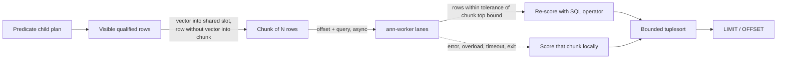

# Worker pipeline for filtered search

The opt-in `AnnFilteredSearch` CustomScan can hand distance scoring to the standalone [C worker](../ann/README.md) while PostgreSQL keeps producing eligible rows. GPU execution is mocked: the `mock-gpu` backend models one device submission per batch (launch latency plus transfer time) and computes exact results on the CPU. There is no Windows support for the worker route; the extension still builds there and always scores locally.

## Enable

```sh
make -C ann
ann/ann-worker --backend mock-gpu --listen /var/run/postgresql/ann.sock
```

```sql
LOAD 'vector';
SET ann.enable_filtered_search = on;
SET ann.worker_socket = '/var/run/postgresql/ann.sock';  -- superuser only
EXPLAIN (ANALYZE) SELECT id FROM documents WHERE tenant = 7
ORDER BY embedding <-> '[...]', id LIMIT 10;
```

The worker must run on the database host as a user that can create sockets where the server can connect. Relative socket paths resolve against the data directory.

| Setting | Default | Meaning |
| --- | --- | --- |
| `ann.worker_socket` | empty (off) | Worker Unix socket. Superuser-only because backends send row vectors to it. |
| `ann.worker_chunk_rows` | 4096 | Eligible rows per worker request. |
| `ann.worker_pipeline_depth` | 4 | Requests a scan keeps in flight. |
| `ann.worker_shared_memory_mb` | 64 | Per-backend segment for chunk vectors; 0 sends vectors over the socket. Superuser-only. |
| `ann.worker_timeout_ms` | 30000 | Time without worker progress before the scan scores locally. |

| Worker option | Default | Meaning |
| --- | --- | --- |
| `--backend` | `cpu-exact` | `cpu-exact` or `mock-gpu` (`cuvs` in the separate cuVS build). |
| `--lanes` | online CPUs | Concurrent backend submissions. |
| `--max-batch` | 64 | Jobs per submission. Lanes leave queued work for idle lanes. |
| `--delay-us` | 0 | Optional wait to fill a partial batch while no lane is idle. |
| `--max-pending-mb` | 512 | Admission budget for queued and running work across all connections. |

`ANN_MOCK_GPU_LAUNCH_US` (default 100) and `ANN_MOCK_GPU_GBPS` (default 12) tune the mock device.

## Execution



The route applies only when `LIMIT + OFFSET` is a positive bound no larger than half a chunk, and the query vector is not NULL. Otherwise the scan uses the existing exact CPU path.

1. The child plan runs normally, so visibility, row-level security, rechecks and quals are unchanged.
2. Each eligible row is split: its vector goes into this chunk's slot of a POSIX shared-memory segment that the worker maps read-only, and the rest of the row is kept as a minimal tuple without the vector. NULL vectors sort last, so only the first `bound` of them are kept. Vectors whose dimensions differ from the query go through the SQL operator, which raises its usual error.
3. A full chunk is sent as a request carrying an offset and the query. The scan keeps reading child rows while up to `ann.worker_pipeline_depth` requests are outstanding. Replies may arrive in any order. Ready replies are collected without blocking. If the pipeline is still full, the backend scores the new chunk itself instead of waiting.
4. For each chunk, the worker returns every row whose distance is within a 1e-3 relative tolerance of the chunk's `bound`-th distance, including ties. Each row in the global top `bound` is also in its own chunk's top `bound`, so only returned rows can matter. The backend rebuilds those rows, recomputes distances with the SQL operator, and feeds them to the bounded tuplesort. Secondary sort keys, ties and NULL ordering therefore follow normal SQL semantics. The tolerance covers the gap between the worker's float sums and PostgreSQL's own rounding for up to 2,000 dimensions.
5. Overload, request errors, malformed replies, timeouts, a lost connection or a worker exit make the affected chunks score locally. After a transport failure, the rest of that scan stays local. Results stay exact in every case.

Each backend keeps one worker connection and segment across scans. The segment is unlinked as soon as the worker attaches, so it disappears when either process exits. A scan that errors out leaves replies outstanding, so the next scan reconnects. A scan nested inside another scan (for example, through a function in the predicate) scores locally, so it never reuses the outer scan's slots. Worker threads never call PostgreSQL APIs.

EXPLAIN reports `Search Route: worker pipeline after predicates` with `Worker Chunks`, `Local Chunks` (fallbacks and chunks scored locally while the pipeline was full) and `Worker Candidates` when the route ran. `Distance Evaluations` then counts only the backend re-scores.

## Protocol additions

Operations 7–10 are served only in `--listen` mode, together with 0 (capabilities), 5 (probe) and 8 (statistics); index operations remain in stdin mode. Headers keep the version 1 layout, and the generation field is zero.

| Operation | Request | Success result |
| --- | --- | --- |
| 7 gathered search | u32 rows, dimensions, k, metric; FP32 query; FP32 row-major vectors | u32 count, `(u32 row, FP64 distance)` sorted by distance |
| 8 statistics | Empty | JSON: jobs, batches, max batch, rows, rejected, failed, pending bytes |
| 9 attach shared | Segment name `/pgann.*` | Empty; maps it read-only for this connection |
| 10 shared search | u32 rows, dimensions, k, metric; u64 byte offset; FP32 query | As operation 7 |

Status 7 (overloaded) is returned without queueing when the admission budget would be exceeded. The client must not modify a shared range until its reply arrives.

## Measured throughput

Run on a 10-core Apple M-series laptop with PostgreSQL 17.6 and one `mock-gpu` worker (default options). Data: 100,000 rows, 256 dimensions, a 25% tenant filter (25,000 eligible rows), `LIMIT 10`, random query vectors, `pgbench -M prepared` with sleep disabled. A macOS background daemon used up to about 3 cores intermittently during these runs, so local and worker runs were interleaved: 7 rounds of 4 s each, reporting the median.

| Clients | Local exact (tps) | Worker pipeline (tps) | Change |
| --- | --- | --- | --- |
| 1 | 86 | 113 | +33% |
| 4 | 246 | 292 | +19% |
| 8 | 359 | 373 | +4% |
| 16 | 361 | 390 | +8% |

At low concurrency, pipelining overlaps the predicate scan with scoring on other cores. Measured alone, a query costs 11.7 ms of CPU locally against 9.2 ms on the worker route (8.2 ms in the backend plus 1.0 ms in the worker). The backend sorts about 1% of the rows instead of all of them. Under full load both routes cost more CPU per query, and the margin narrows to the single digits because the mock still scores on the host.

Single uninterleaved runs under that background load varied by up to 25% between consecutive runs and sometimes showed the worker route behind. Use interleaved medians when comparing routes on a shared machine. An adaptive router that chose routes by measured elapsed time per row was tried and removed: it did worse than always using the worker, because elapsed time hides CPU used by other processes and exploration scans cost throughput.

Changes that each made a measurable difference during development:

- **Shared-memory vectors.** Sending about 25 MB per query through a Unix socket capped throughput near 210 tps; shared memory removed that ceiling.
- **Vectorizable float kernel with linear selection.** This replaced a full heap and sort over every row.
- **Fair lane batching.** Previously one lane could take the whole queue and run it serially while other lanes sat idle.
- **Chunk tuples without the vector.** The vector is copied once, into the shared slot, instead of twice.
- **Score locally instead of waiting.** When the pipeline is full, the backend scores the chunk itself instead of blocking, so a busy worker sheds load to its clients.

At 64 dimensions, where scoring is cheap, the worker route is slightly slower than local scoring (`benchmarks/ann/pipeline.sh 20000 64`).

## Tests and benchmark

```sh
make -C ann check                                   # includes test/ann/test_server.py
make installcheck                                   # unavailable-worker fallback in ann_filtered
ANN_PG_DSN='host=... dbname=...' python3 test/ann/test_pipeline.py
ANN_PG_DSN='host=... dbname=...' benchmarks/ann/pipeline.sh 100000 256
```

- `test_server.py` covers pipelined out-of-order replies across connections, batching under a slow mock launch, boundary ties, invalid frames, admission rejection and disconnects with pending work.
- `test_pipeline.py` runs through `psql`, and its server must be local. It compares the worker route with local scoring over 75 query/limit/offset combinations, and covers the socket transport without shared memory, overload fallback, timeout fallback, and a worker killed mid-scan.

Remaining work: validate on a real cuVS host, fit the route decision to measured costs instead of the fixed half-chunk rule, supervise the worker process from PostgreSQL, and run sustained-load and fault tests on Linux.
