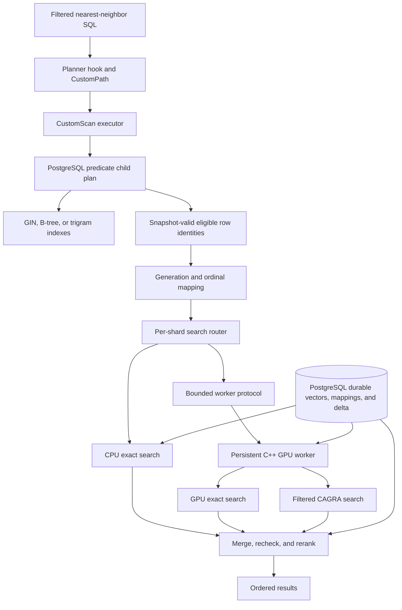
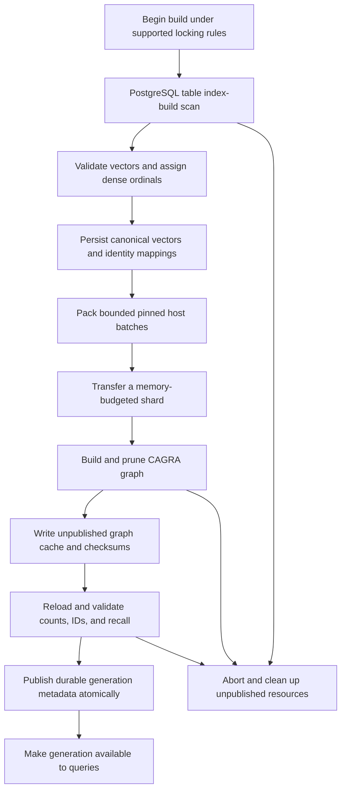
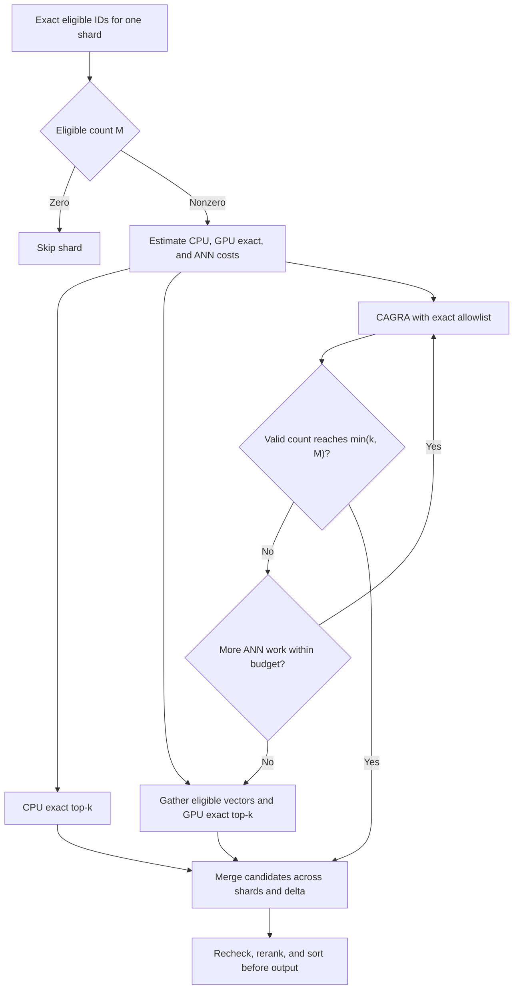
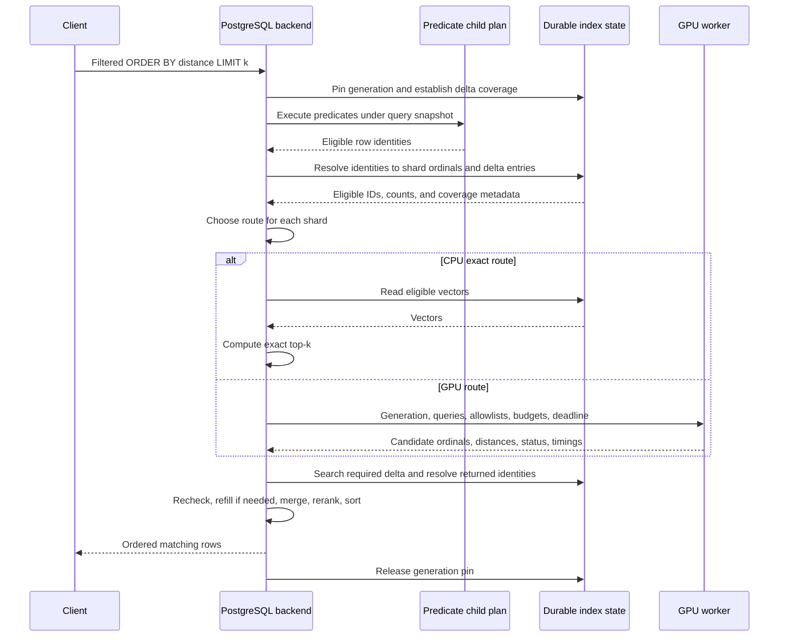
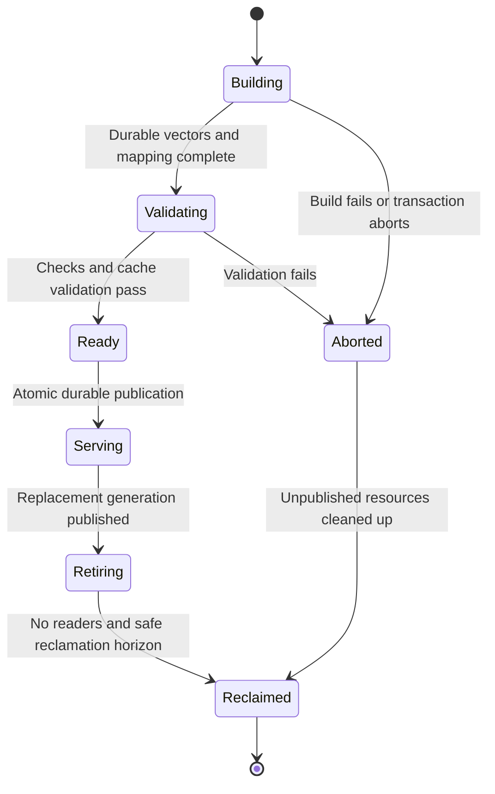
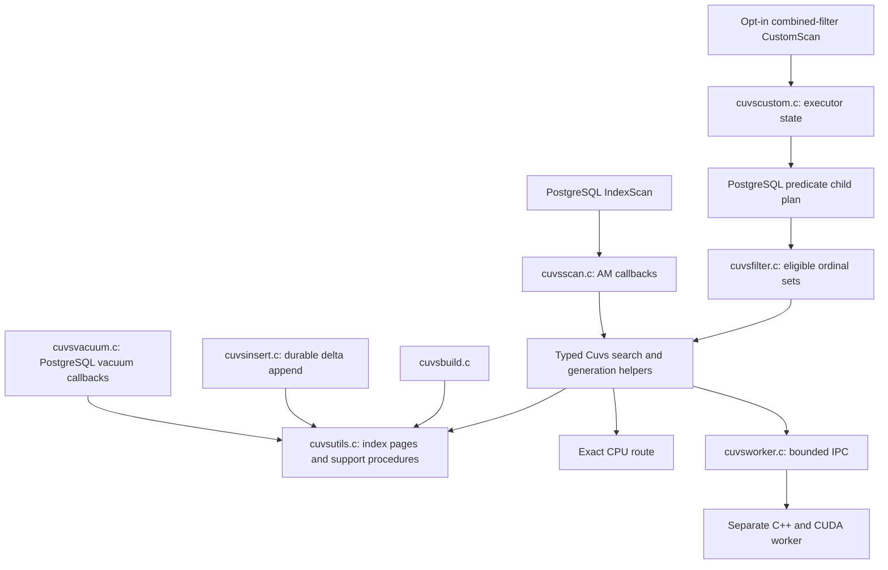

# cuVS bulk build and filtered ANN implementation plan

Status: proposed; no implementation accompanies this document.

Prepared: 2026-10-30. cuVS capability checks below refer to released **v26.10.00**. Compile and runtime smoke tests remain implementation work.

## 1. Objective and scope

Build a PostgreSQL integration that uses cuVS for bulk vector index construction and query execution while supporting both:

- Full-text predicates expressed with `tsvector`, `tsquery`, and PostgreSQL text-search configurations.
- Text metadata predicates such as tenant equality, categories, tags, and supported substring searches.

“Highly selective” means a filter permits only a small fraction of the indexed rows. Text predicates determine eligibility; vector distance determines result order. Combining lexical relevance scores with vector scores is a separate feature and is outside the initial scope.

The core design is **PostgreSQL eligibility evaluation followed by adaptive vector search over eligible IDs**. For a small matching set, exact search is a first-class execution strategy. For a larger set, use filtered CAGRA search.

The target SQL shape is ordinary single-table filtered nearest-neighbor search:

```sql
SELECT id, embedding <=> $1 AS distance
FROM documents
WHERE tenant = 'acme'
  AND tags @> ARRAY['database']
  AND search_text @@ websearch_to_tsquery('english', 'query optimization')
ORDER BY distance
LIMIT 20;
```

This query illustrates the intended integration, not an existing cuVS execution path. Initial prototypes use an explicit experimental entry point; planner integration follows after correctness and performance are established.

### Initial assumptions

- A Linux host with a supported NVIDIA GPU runs the cuVS worker. The PostgreSQL adapter and documentation can be developed separately from GPU execution.
- The first prototype operates on an explicitly immutable dataset with a stable primary key.
- Start with one GPU, dense FP32 vectors, L2 distance, and a supported PostgreSQL major version selected during setup. Add cosine and inner product behind semantic tests.
- Initial prototype inputs are non-null and satisfy the selected metric's validation rules. Unsupported inputs or query shapes must fail explicitly or retain the ordinary PostgreSQL plan.
- Dataset size, embedding dimension, GPU memory, write rate, and latency/throughput targets are not yet specified. Benchmark-derived defaults and hardware sizing remain open decisions.

### Result contract

- Every returned row must satisfy the SQL predicates and be visible under the query snapshot.
- Exact routes compute top-k within the eligible set, subject to documented numeric tolerance and tie handling.
- ANN routes approximate membership in top-k; returned candidates are reranked and emitted in distance order. Returning k rows does not establish recall.
- Aim to return `min(k, M)` rows, where `M` is the number of eligible searchable vectors. If ANN underfills, expand the search or use the exact route. A deadline or resource failure must not be reported as proof that no more matches exist.
- PostgreSQL's distance conventions remain authoritative. Normalize or convert cuVS distances as necessary before exposing results.

## 2. Why the existing scan path needs more than a GPU replacement

The current HNSW and IVFFlat access methods return candidate heap TIDs. PostgreSQL fetches the heap rows, checks visibility, and applies predicates afterward. Iterative scanning can request additional candidates, but the ANN scan itself does not receive the qualifying text ID set.

Relevant local code:

| File | Relevant behavior |
| --- | --- |
| [src/hnsw.c](../src/hnsw.c) | Registers the HNSW access method; currently has no predicate strategies, multicolumn support, or bitmap callback. |
| [src/hnswscan.c](../src/hnswscan.c) | `GetScanItems`, `ResumeScanItems`, and `hnswgettuple` produce and resume ANN candidates. |
| [src/hnswbuild.c](../src/hnswbuild.c) | `table_index_build_scan`, build callbacks, and durable index construction provide patterns for native integration. |
| [src/ivfflat.c](../src/ivfflat.c) | Registers the IVFFlat access method with similar filtering integration limits. |
| [src/ivfscan.c](../src/ivfscan.c) | Selects lists, sorts candidate batches, and emits heap TIDs. |
| [README.md: Filtering](../README.md#filtering) | Documents post-scan filtering and iterative scans. |

Add a new `cuvs` access method following the existing HNSW/IVFFlat lifecycle, then an opt-in `CustomPath`/`CustomScan` for supported combined queries. Keep ordinary AM scanning and combined-filter execution separate: the AM takes order-by keys and emits heap TIDs; the custom executor connects PostgreSQL predicate evaluation to the GPU allowlist. Simply creating a GIN index and a cuVS index will not make PostgreSQL perform this connection automatically.

PostgreSQL describes custom scans as an extension mechanism for alternative execution, including hardware acceleration. Its interfaces require version-specific integration and validation. See [Writing a Custom Scan Provider](https://www.postgresql.org/docs/current/custom-scan.html).

## 3. Component architecture



### PostgreSQL backend

- Own the query snapshot, SQL expression evaluation, permissions, row visibility, cancellation, and final tuple production.
- Evaluate predicates through an ordinary PostgreSQL child plan, retaining required security qualifications.
- Translate row identities into vector ordinals and choose a search route using actual eligible counts.
- Merge base and delta results, recheck as required, compute authoritative distances, and sort before returning rows.

### Persistent GPU worker

- Own CUDA contexts, streams, resident indexes, reusable device buffers, and cuVS objects.
- Execute build, load, exact-search, and ANN-search requests through a versioned protocol.
- Use bounded admission queues, memory reservations, request deadlines, and cancellation checks.
- Cancellation stops admission and additional work and discards unwanted results. Already submitted CUDA work may continue; retain buffers, allowlist owners, and index references until stream/event completion before reclaiming them.
- Report structured failures and per-stage timings. A worker crash must not corrupt PostgreSQL state.
- Start CUDA in a dedicated process with a defined lifecycle; do not initialize CUDA in the postmaster or create one independent resident index copy per backend.

Prefer a local worker for the first deployment. Remote GPU transport adds network latency, authentication, and failure modes and should be a separate milestone.

### Durable state and GPU cache

PostgreSQL index relation pages are authoritative for vectors, tuple mappings, generation metadata, and the mutable delta. Use the existing buffer-manager and generic-WAL patterns for recoverable changes. GPU-resident indexes are reconstructible caches.

Persist graph artifacts as versioned, checksummed caches that can be rebuilt from durable vectors and mappings. An incompatible or missing graph artifact triggers reload/rebuild or an exact fallback; it must not silently remove rows from the searchable dataset. Design the index page/metapage layouts and generic-WAL update boundaries before implementing mutable storage. Introduce custom WAL records only if a demonstrated limitation requires them.

## 4. cuVS capabilities and binding constraints

Pin the initial dependency to [cuVS v26.10.00](https://github.com/NVIDIA/cuvs/releases/tag/v26.10.00), along with a compatible CUDA/toolchain configuration. Do not infer released behavior solely from rolling documentation or another language binding.

| Capability | Implementation choice or constraint |
| --- | --- |
| Bulk ANN construction | Build CAGRA shards; compare NN-Descent and IVF-PQ initial-graph builders. |
| Shared filter | A dense bitset permits or rejects each dataset row; bit 1 means allowed. |
| Different filters per query | Use direct C++ CAGRA search with per-query Roaring allowlists. |
| C binding | Released CAGRA C search accepts `NO_FILTER` and `BITSET`, and rejects `BITMAP`. |
| Roaring batching | Direct C++ `cagra::search` supports Roaring; cuVS dynamic batching and tiered search reject this filter type. |
| Multi-GPU wrapper | The released C multi-GPU CAGRA search signature has no filter argument. Use explicit filtered shard searches and merge. |
| Exact search | Compare gathered eligible vectors plus brute force with cuVS filtered brute force. Include CPU exact search for tiny sets. |

Sources: [released CAGRA C implementation](https://github.com/NVIDIA/cuvs/blob/v26.10.00/c/src/neighbors/cagra.cpp), [C++ filter contracts](https://github.com/NVIDIA/cuvs/blob/v26.10.00/cpp/include/cuvs/neighbors/common.hpp), and [multi-GPU C implementation](https://github.com/NVIDIA/cuvs/blob/v26.10.00/c/src/neighbors/mg_cagra.cpp).

At configuration time, compile smoke programs covering every required capability. At runtime, validate build/search/serialize/reload, filter polarity, ID domains, dtype, dimensions, metrics, invalid-neighbor sentinels, and fewer-than-k behavior.

Keep graph navigation intact when applying output eligibility. Removing rejected nodes from navigation can disconnect useful search paths. Use cuVS's supported filtering interface rather than adding an ad hoc graph-pruning rule. Filtered CAGRA still has approximate recall.

## 5. Text eligibility and filter transport

### Predicate support

| Predicate | Initial handling |
| --- | --- |
| `tsvector @@ tsquery` | Native PostgreSQL text execution, normally with GIN acceleration. Preserve dictionaries, language configuration, phrases, and weights. |
| Text equality and `IN` | Native comparisons and available B-tree/bitmap paths, preserving collation and null semantics. |
| Tags and array membership | Native array semantics and suitable GIN paths. |
| `LIKE` / `ILIKE` | Ordinary PostgreSQL evaluation; use a supported trigram index when available. |
| Boolean combinations | Let the child plan evaluate the complete supported expression; do not intersect IDs for an `OR` expression. |
| Joins, volatile predicates, complex subqueries | Retain the ordinary plan until a dedicated supported execution contract exists. |

GIN and bitmap results can require heap and expression rechecks. A raw index bitmap must not be treated as an exact list of visible matches. PostgreSQL's [text-index documentation](https://www.postgresql.org/docs/current/textsearch-indexes.html) explains relevant recheck requirements.

For the first implementation, materialize the exact qualifying set before vector search. This makes correctness and routing clear but can be expensive for broad predicates. Measure that cost. A later optimization may use a conservative superset with residual rechecks and refill; it requires a separate correctness gate and may never exclude valid candidates because of an approximation in filter construction.

### ID conversion and representation

1. Execute the predicate child plan under the query snapshot.
2. Resolve each eligible row to its indexed vector-version identity.
3. Separate IDs by pinned generation, shard, and delta segment.
4. Produce exact local eligible counts.
5. Use sorted sparse IDs for exact gathers, Roaring for selective ANN allowlists, or a dense bitset when appropriate.
6. Validate that every encoded ID belongs to the target shard's ordinal domain.

A dense mask costs approximately `N / 8` bytes per shard/filter. Distinct dense masks for `Q` queries cost `Q * N / 8`; at 100 million vectors, one mask is 12.5 MB. Reuse buffers and avoid constructing a full dense mask for every sparse request.

Roaring allowlist owners must outlive all searches referencing their views. Batch compatible queries by generation, shard, metric, dtype, and selectivity. A sparse query can inflate CAGRA's batch-wide filtering estimate, so group disparate selectivities separately. These constraints are specified in the [released C++ filter API](https://github.com/NVIDIA/cuvs/blob/v26.10.00/cpp/include/cuvs/neighbors/common.hpp).

Cache eligible sets only with an explicit validity model covering generation, predicate parameters, role/security context, relevant data changes, and snapshot visibility. A normalized SQL string or generation ID alone is not sufficient for caching a snapshot-valid allowlist.

## 6. Bulk build and publication



### Build steps

1. Validate the table, metric, dimension, input constraints, PostgreSQL version, GPU capabilities, and memory budget.
2. For the prototype, freeze writes to the source dataset. For the native AM, use PostgreSQL's index-build APIs and initially support a build that blocks writes.
3. Scan through `table_index_build_scan` for native integration. Do not replace PostgreSQL's index-build visibility rules with an ordinary `SELECT` snapshot: index contents must cover tuple versions that supported snapshots may need.
4. Assign dense ordinals within a generation and shard. Persist the vector and its durable row-version mapping.
5. Pack vectors into contiguous batches and overlap host preparation with transfer where measured to help. Bounded transfers do not make the CAGRA graph builder itself out-of-core; each build shard must fit its peak budget.
6. Build each shard with the selected CAGRA parameters. Record input size, builder, graph degree, metric, dtype, seed where applicable, versions, and timing.
7. Serialize to an unpublished temporary graph artifact. Reload it and validate ID ranges, count consistency, checksums, and sample recall against exact neighbors.
8. Publish the complete generation through PostgreSQL-managed metadata. Partial generations remain unavailable to queries.
9. Release temporary buffers. Retain an older serving generation until its readers and required snapshot coverage permit retirement.

CAGRA constructs an initial graph and prunes it. Construction workspace can materially exceed the final index size; profile both initial graph builders on representative data. See the [CAGRA build and memory guide](https://docs.nvidia.com/cuvs/user-guide/api-guides/indexing-guide/cagra).

### Memory planning

For `N` vectors, dimension `D`, component width `B`, graph degree `G`, and neighbor-ID width `I`:

```text
Vector bytes             = N * D * B
Final graph bytes        ≈ N * G * I
One dense filter bytes   ≈ N / 8
Required memory          = resident vectors + graph + mappings + filters
                           + search workspace + build workspace
                           + overlapping generations + allocator overhead
```

For 10 million 768-dimensional FP32 vectors, the vectors occupy 30.72 GB and a degree-64 graph with 32-bit neighbors adds about 2.56 GB, using decimal units. These are component sizes, not a GPU sizing recommendation. Concurrent builds, serving traffic, and old/new generations need additional headroom.

Start with explicit independently searchable shards. Partition pruning is allowed only when metadata proves that a shard cannot contain a match. Hash sharding generally requires searching every nonempty eligible shard; tenant partitioning helps only when the predicate permits sound pruning.

## 7. Adaptive query execution



### Routing model

Estimate the following using measured coefficients, not fixed universal percentages:

```text
CPU exact cost  = vector access + CPU distance evaluation(M, D) + top-k
GPU exact cost  = queue + eligible-vector gather + transfers
                  + GPU distance evaluation(M, D) + top-k
GPU ANN cost    = queue + allowlist construction/upload
                  + filtered traversal + candidate transfers + reranking
```

Include shared predicate evaluation and ID-conversion costs when comparing the complete custom path to an ordinary PostgreSQL plan. Routing should consider `M`, `D`, `k`, residency, eligible-set layout, concurrency, and batch size.

For example, 0.1% of 10 million vectors leaves 10,000 candidates. Exact search over those candidates may be faster than filtered graph traversal. Gather only eligible vectors, or benchmark cuVS's filtered brute-force implementation; do not assume that filtering after a full distance matrix gives the same cost. NVIDIA recommends brute force for heavily filtered workloads in its [brute-force guide](https://docs.nvidia.com/cuvs/user-guide/api-guides/indexing-guide/brute-force).

### End-to-end request sequence



### Ordering, refill, and planner restrictions

- Materialize the candidate set before advertising ordered output. Retry batches can discover closer candidates than earlier batches.
- Treat CAGRA search as a top-k request, not a resumable pgvector `ResumeScanItems` cursor. Expanding the candidate/search budget launches another search; deduplicate the accumulated candidates by generation, shard, and ordinal, and materialize their union before final ordering.
- Match distance semantics: cuVS squared L2 may require conversion for pgvector L2 output; cosine normalization and inner-product sign conventions require tests. Final reranking should use the same defined metric as the SQL operator.
- Discard invalid-neighbor sentinels before ID lookup. Handle `M < k`, duplicates, equal distances, and empty shards explicitly.
- If every shard search is exact and filtering is complete, each shard's local top-k is sufficient for exact global top-k. ANN searches need measured oversampling and recall validation.
- Search all shards that might contain eligible rows. Query base and delta without gaps, and deduplicate overlapping index-entry identities during transitions.
- Push `LIMIT` into the custom execution only for proven query shapes. OFFSET, joins, residual qualifications, security qualifications, and parameterized plans require explicit handling; otherwise preserve the standard plan.
- Keep a sort above the custom scan until its path-ordering claim is verified. Do not label an approximate ANN result as exact because its final distances are sorted.
- For broad predicates, allow the planner to choose another path when exact eligibility materialization dominates total cost.

## 8. Identity, MVCC, and mutable operation

### Prototype identity

On an immutable dataset, a stable SQL primary key can map to a dense ordinal. This shortcut is valid only while the dataset is frozen. Reusing a primary key after deletion or storing multiple vector versions requires production identity handling.

Enforce immutability at the table level. For the experimental build/query test window, a dedicated coordinator can hold a PostgreSQL `SHARE` table lock on each source table; release or loss of that lock invalidates the prototype's registration. A copied source table still needs protection against writes and rewrites. Checking only an index insert callback is insufficient: DELETE, TRUNCATE, and HOT updates can bypass that callback. This long-held lock is a test-only mechanism, not the mutable production design.

### Production identity

Use `(index generation, shard, ordinal)` for GPU references. Ordinals are never reused within a generation. The durable mapping points to the appropriate indexed tuple/version lineage.

PostgreSQL heap identity requires special care:

- A filter scan may return a visible HOT-chain member, while the index entry refers to the HOT root.
- Resolve the root/member relationship under appropriate table/buffer synchronization, or preserve root identity while rechecking the child-plan results.
- Coordinate ordinal retirement with VACUUM and heap TID reuse. A stale GPU hit must never resolve to an unrelated row that later occupied the same heap location.
- Initially support heap tables only. Other table access methods need their own identity and fetch contract.

### Immutable base plus durable delta

Capture inserts and indexed updates synchronously in PostgreSQL-managed WAL-protected state. GPU refresh is asynchronous; search visibility cannot depend on refresh completing.

The delta records vector entries and their durable identities. Non-HOT indexed updates create new entries. Deletes need not immediately erase graph nodes: heap visibility rejects deleted versions when appropriate, while old snapshots may still require them. Physical cleanup follows PostgreSQL's safe reclamation horizon.

Queries must include committed changes visible to their snapshot and the transaction's own visible writes. WAL order, cache freshness, and a global live/dead bitset are not substitutes for MVCC.

### Generation lifecycle



Publication must define an explicit coverage boundary between the base and delta. An LSN or entry-sequence watermark can identify copied data, but visibility still comes from PostgreSQL. Concurrent and long-running transactions must not fall through a gap at that boundary.

Compaction must preserve versions required by supported snapshots. Retain old base/delta coverage until it is safe to retire it; reader pins alone do not prove that old tuple versions can be discarded. Specify and test these invariants before enabling mutable tables or concurrent rebuilds.

### Recovery and availability

- Persist canonical vector and mapping changes through PostgreSQL's recovery machinery. Graph cache files alone do not provide transactional durability.
- On restart, validate metadata and artifact checksums before loading a graph. Rebuild an incompatible or missing graph from canonical state.
- Recover or clean up unpublished generations without exposing partial data.
- Define backup/restore and replica behavior. GPU-less replicas should retain a correct exact fallback or report a documented unavailable path, rather than silently using stale data.
- Tag every worker request and response with generation identity and validate it before consuming results.
- If the worker fails, release request resources and run an authorized fallback within the query deadline, or return an explicit error.

## 9. Repository architecture and code-style alignment

The PostgreSQL adapter should look like another pgvector access method. Keep the genuinely new pieces, filtered CustomScan execution and the GPU worker, behind narrow interfaces. Do not add a generic vector-backend registry, storage engine, scheduler framework, or alternate text-query language.

### Existing conventions to follow

| Repository reference | Apply to the cuVS implementation |
| --- | --- |
| [.editorconfig](../.editorconfig) | Tabs with width 4 for C, headers, Perl, and SQL. Match neighboring PostgreSQL-style code. |
| [src/vector.c](../src/vector.c) | One extension entry point, `_PG_init()`, with a new `CuvsInit()` alongside `HnswInit()` and `IvfflatInit()`. |
| [src/hnsw.c](../src/hnsw.c) | Handler registration, bounded reloptions, GUC definitions, costing, opclass validation, and version guards. |
| [src/hnsw.h](../src/hnsw.h) | AM-specific constants, support procedures, page layouts, state structs, and shared helper declarations. |
| [src/hnswscan.c](../src/hnswscan.c) | Begin/rescan/gettuple/end callbacks, opaque scan state, and scan-local memory ownership. |
| [src/hnswbuild.c](../src/hnswbuild.c) | Build state, table-AM scan callback, progress, index forks, and build-time page WAL. |
| [src/hnswinsert.c](../src/hnswinsert.c), [src/hnswvacuum.c](../src/hnswvacuum.c) | Durable insertion, vacuum callbacks, buffer locks, and resource cleanup. |
| [src/hnswutils.c](../src/hnswutils.c) | Opclass support lookup, metapage/page helpers, and generic WAL updates. |
| [Makefile](../Makefile), [Makefile.win](../Makefile.win) | PGXS/Windows C builds, SQL generation, installation, and existing test entry points. |
| [sql/vector.sql](../sql/vector.sql) | Canonical install SQL, handlers, access methods, operators, and opclasses. |

### AM scanning and CustomScan are separate paths



- The ordinary AM implements `cuvsbeginscan`, `cuvsrescan`, `cuvsgettuple`, and `cuvsendscan` with `CuvsScanOpaqueData`. Read the scan descriptor's order-by keys and return `xs_heaptid`; set recheck flags according to the actual distance/qual contract. This path does not receive arbitrary WHERE expressions or the query's LIMIT.
- The custom executor has a distinct `CuvsCustomScanState`. It owns its predicate child plan, eligible sets, safe top-k pushdown, and final row production. Do not pass executor state through AM-private fields or assume that a normal scan has the custom path's information.
- Share narrowly typed helpers such as `CuvsSearch` and generation lookup. The inputs describe the metric, query vector, optional eligible ordinals, and search budget; results contain generation-scoped candidates and status. An opaque PostgreSQL `PlanState`, CUDA pointer, or C++ object is not a cross-process request format.
- Keep HNSW/IVFFlat scans and their on-disk formats independent. Reuse public vector representations and distance semantics; do not make cuVS depend on HNSW graph internals.

### Proposed modules

These names describe planned responsibilities; none of these new files or APIs exists yet. Add files as their responsibilities are implemented, rather than creating empty layers in advance.

| Proposed location | Responsibility |
| --- | --- |
| `src/cuvs.c`, `src/cuvs.h` | `CuvsInit`, `cuvshandler`, options, support constants, state structs, and shared declarations. |
| `src/cuvsbuild.c` | `cuvsbuild`, `cuvsbuildempty`, table build callback, packing, ordinal assignment, and publication. |
| `src/cuvsscan.c` | Ordinary AM begin/rescan/gettuple/end callbacks and `CuvsScanOpaqueData`. |
| `src/cuvsinsert.c` | `cuvsinsert`, validation, synchronous delta append, and refresh notification. |
| `src/cuvsvacuum.c` | `cuvsbulkdelete`, `cuvsvacuumcleanup`, safe reclamation, and vacuum statistics. |
| `src/cuvsutils.c` | Support-procedure lookup, index page/metapage helpers, generic WAL, mapping and generation access. |
| `src/cuvsplan.c` | Opt-in planner hooks, supported-shape detection, costing, and CustomPath creation. |
| `src/cuvscustom.c` | CustomScan callbacks, predicate child plan, routing, merge, reranking, and row production. |
| `src/cuvsfilter.c` | Eligible-ID conversion, shard grouping, and portable filter encoding. |
| `src/cuvsworker.c` | Portable C client protocol, request ownership, availability checks, and error translation. |
| `cuvs/` | Separately built C++/CUDA executable, cuVS adapter, and worker-owned GPU resource management. |
| `test/sql/`, `test/expected/`, `test/t/` | Regression pairs and TAP tests following the existing harness. |
| `benchmarks/cuvs/` | Reproducible bulk-build and filtered-query benchmarks, separate from regression expectations. |

The delta is an index data structure maintained by insertion, vacuum, and generation helpers. Start within these AM modules. Split out a dedicated storage or delta file only when real implementation size and ownership justify it; do not create a second transactional subsystem.

### C style and state ownership

- Put `#include "postgres.h"` first in backend C files. Follow neighboring include grouping, brace placement, declarations, and short `/* ... */` comments explaining intent or invariants.
- Use lowercase AM callbacks (`cuvsbuild`), `Cuvs`-prefixed shared helpers and types (`CuvsBuildState`), uppercase constants (`CUVS_*`), and `static` file-local helpers (`BuildCallback`, `InitBuildState`). Keep headers private unless an external consumer needs them.
- Use the existing handler export convention, including `FUNCTION_PREFIX PG_FUNCTION_INFO_V1(cuvshandler)`. Match local `PG_VERSION_NUM` guards where PostgreSQL callback signatures or AM fields differ.
- Allocate backend state with PostgreSQL allocation APIs and build/scan/vacuum memory contexts. Reset `tmpCtx` between appropriate batches or tuples. Use checked size arithmetic such as `add_size` and `mul_size` for vector, ordinal, and filter buffers, including 32-bit builds.
- Use `ereport` with suitable SQLSTATE/detail/hint for user-facing failures and the existing `elog` style for internal invariants. Place `CHECK_FOR_INTERRUPTS()` in long CPU loops and use interruptible PostgreSQL wait facilities for worker requests.
- Release generation pins, external handles, and requests on rescan, normal end, ERROR, cancellation, and transaction abort through appropriate PostgreSQL resource/error cleanup. Memory-context deletion alone does not finish external GPU work.
- Keep C++ exceptions, STL types, CUDA headers, and cuVS resource ownership inside the worker. Return structured errors over the protocol. Define fixed-width wire fields and explicit encoding; do not serialize raw PostgreSQL structs or process pointers.
- `.editorconfig` currently does not define `.cpp` or `.cu` formatting. Add a scoped worker formatting policy when introducing those files; do not reformat existing C sources as part of the integration.

### Initialization, SQL semantics, and configuration

`CuvsInit()` should register bounded index options and `cuvs.*` GUCs and reserve the GUC prefix. It must not connect to a worker, create a CUDA context, allocate large queues, or require a worker merely to load `vector`.

Use reloptions for persistent build properties such as graph degree, and GUCs for per-query search budgets and experimental planner enablement. Derive backend CPU budgets from appropriate PostgreSQL settings such as `work_mem` and `maintenance_work_mem`, with separate explicit GPU/queue limits. Do not imitate HNSW's tiny shared-memory tranche-ID allocation for substantial worker queues; shared memory would require proper sizing and lifecycle registration.

Planner hooks are new to this repository. Make installation deliberate, chain any previous hooks, and keep combined-filter planning opt-in initially. Establish the enabled state before a statement is planned; an AM handler loaded only during execution is too late. Test fresh sessions, prepared plans, and disabled/unsupported cases. Do not require `shared_preload_libraries` for ordinary pgvector use; any future worker-supervision preload requirement is an explicit deployment option.

Read distance and normalization support through the index opclass, following `HnswInitSupport`. Map only verified supported procedures to GPU metrics; unfamiliar opclasses must use a semantically valid CPU path or be rejected. Do not hard-code operator OIDs or infer a metric from an unqualified SQL name. Reuse the existing `vector` type and operators, with cuVS-specific opclass entries such as `vector_l2_ops ... USING cuvs`.

Advertise only implemented AM capabilities. Initially keep multicolumn, INCLUDE, bitmap, parallel scan, and parallel build support disabled unless implemented and tested. GPU parallelism is not PostgreSQL parallel-index-scan/build support. GPU failures and exact fallbacks must preserve the declared SQL/operator contract.

### Storage, WAL, and locks

- Give the cuVS index its own versioned metapage and page/tuple layouts. Keep canonical vectors, ordinal mappings, delta entries, and generation metadata in index-owned storage.
- Follow `ReadBuffer`/`ReadBufferExtended`, buffer locks, `GenericXLogStart`/`GenericXLogRegisterBuffer`/`GenericXLogFinish`, and `UnlockReleaseBuffer` patterns for updates. Follow build-time `log_newpage_range` and `RelationNeedsWAL` handling where appropriate. Prefer PostgreSQL generic WAL to a new custom resource manager.
- Use `table_index_build_scan`, return `IndexBuildResult` counts, and report progress through the existing build-phase conventions. Handle `MAIN_FORKNUM` and `INIT_FORKNUM` deliberately; implement unlogged/temporary behavior correctly or reject it explicitly during the experimental phase.
- Have `cuvsinsert` append durable entries before an asynchronous refresh can observe them. Have `cuvsbulkdelete` use PostgreSQL's deletion callback to determine reclaimable heap identities, with `cuvsvacuumcleanup` reporting statistics. A worker's view of live rows does not replace these callbacks.
- Copy bounded batches under the necessary buffer locks, pin the logical generation, release buffer content locks, then submit GPU work. Never wait for IPC, queue admission, or GPU completion while holding buffer content locks or inside a critical section.
- Specify lock order for publication, insertion, and vacuum. Keep these logical locks and generation pins distinct from short-lived buffer locks and from the worker's device-reference lifetime.
- Invalidate cached identities on relevant DROP, TRUNCATE, REINDEX, and relation-rewrite transitions. Cache keys must include database, physical index identity, and generation; an index OID alone is insufficient. The worker must not modify PostgreSQL relation files or act as an independent WAL writer.

### Build, installation, and upgrade contract

The chosen packaging model is a **portable C adapter in `MODULE_big = vector`, with a separately built optional GPU worker**. Every symbol referenced by installed SQL exists in CPU-only and GPU installations. Unavailable worker operations return a documented error or a supported exact fallback; they do not cause `CREATE EXTENSION` to fail because a handler was omitted from the library.

1. Add portable adapter objects to both `Makefile` and `Makefile.win`. Keep CUDA headers, C++ linking, and cuVS package discovery out of the top-level PGXS build. Use portable unavailable-worker behavior where the initial Linux transport is unsupported.
2. Build the worker through an explicit subdirectory build or separate target. Ordinary `make`, installation, tests, and uninstall must not download or require CUDA. Worker lifecycle/supervision is explicit and separate from loading the extension.
3. Add shipped SQL definitions to canonical `sql/vector.sql` and the appropriate future upgrade script. Do not edit only generated `sql/vector--<version>.sql`, which the Makefile copies from the canonical source.
4. Follow the existing handler, access-method, opclass, and COMMENT conventions. Preserve extension membership and relocatability; do not assume objects live in `public`.
5. Test fresh installation and upgrade for identical catalogs, with and without a worker, and in a non-default extension schema. Keep experimental entry points out of release SQL until their supported behavior is defined.
6. Coordinate release versions in both Makefiles, `vector.control`, and `PG_MODULE_MAGIC_EXT` when the feature ships, and update the control-file description then. The checkout currently declares 0.8.7 and includes a draft 0.8.7-to-0.9.0 upgrade; this plan does not select or bump the release.

Conditionally removing handler objects while installing their SQL is not this design. A separately packaged extension would require its own control/install/upgrade lifecycle and a deliberate revision of this packaging decision.

### Tests and CI fit

- Add deterministic regression SQL and matching expected output, such as `test/sql/cuvs.sql` and `test/expected/cuvs.out`, for catalogs, options, supported CPU behavior, and unavailable-worker errors. Configure a controlled unavailable endpoint for those error cases rather than relying on the host having no worker. The Unix Makefile auto-discovers SQL tests; Windows has an explicit `REGRESS` list that must be updated.
- Use numbered TAP tests with `PostgreSQL::Test::Cluster`, `safe_psql`, `Test::More`, and `done_testing()` for planner, lifecycle, recovery, recall, and worker failures. Follow [the existing WAL test](../test/t/010_hnsw_wal.pl) and [iterative recall test](../test/t/044_hnsw_iterative_scan_recall.pl).
- Ordinary regression tests must run without GPU hardware. Gate GPU-specific TAP tests with an explicit opt-in and `plan skip_all` on ordinary hosts; the dedicated GPU CI mode must fail, rather than skip, when its required worker/device is missing.
- Preserve the [current CPU workflow](../.github/workflows/build.yml): Linux/ARM, macOS, Windows, i386, assertions, warnings-as-errors, static analysis, and Valgrind. Add a separate supported-Linux GPU job with pinned cuVS/CUDA. Limiting the first custom/GPU path to one PostgreSQL major must not break the ordinary extension's existing build matrix.
- Use `make installcheck` and `make prove_installcheck`, including existing `REGRESS` and `PROVE_TESTS` selection when developing a focused change. Keep performance benchmarks and GPU latency assertions out of deterministic expected files.

## 10. Implementation steps and delivery gates


### Phase 0: Pin dependencies and establish the baseline

- [ ] Record target PostgreSQL major version, hardware, row counts, dimension, metrics, write rate, `k`, and latency/throughput/recall objectives.
- [ ] Pin cuVS, CUDA, compiler, and worker build configuration; confirm that the portable C adapter fits both PGXS and Windows builds without a CUDA dependency.
- [ ] Review the AM callback boundaries, naming, state ownership, page layout, and proposed SQL objects against the repository conventions in section 9.
- [ ] Compile and run capability smoke tests for bulk build, reload, bitsets, per-query Roaring, exact search, and result edge cases.
- [ ] Generate representative predicates for both full-text and metadata, including their conjunctions.
- [ ] Compute exact filtered ground truth and benchmark current pgvector iterative HNSW and PostgreSQL filter-then-exact plans.

Deliverable: reproducible harness, capability report, and workload manifest. Gate: the selected API combination runs on the target machine and ground truth is independently validated.

### Phase 1: Standalone build/search worker

- [ ] Define fixed-width request/response encoding and generation-scoped ID types without leaking PostgreSQL structs or C++ objects across the process boundary.
- [ ] Implement bounded vector ingestion, CAGRA shard build, serialization, load, and unload.
- [ ] Implement CPU exact reference, GPU gathered exact, GPU filtered brute force, and filtered CAGRA search.
- [ ] Implement same-filter shared-bitset batches and per-query Roaring batches with explicit ownership and range validation.
- [ ] Add per-shard routing, result merge, memory accounting, timings, deadlines, and cancellation behavior.
- [ ] Define request cleanup after PostgreSQL errors and GPU stream completion; verify that submission never requires retaining a backend buffer content lock.
- [ ] Fit preliminary route crossovers from complete search costs, including filter setup and transfers.

Deliverable: worker executable and benchmark reports. Gate: all returned IDs satisfy the supplied allowlist, exact results match the reference, and ANN recall is measured after reload as well as immediately after build.

### Phase 2: Immutable PostgreSQL prototype

- [ ] Enforce the table freeze for the full build/query test window and build stable primary-key-to-ordinal mappings; test writes, rewrites, and freeze loss.
- [ ] Add an experimental search entry point that obtains eligible rows from native PostgreSQL predicate execution.
- [ ] Support both full-text and metadata filters together, including necessary rechecks.
- [ ] Translate eligible identities to shard IDs; route and merge results; rerank and return rows.
- [ ] Instrument filter evaluation, identity mapping, gathering, queue time, upload, search, download, and reranking.
- [ ] Compare end-to-end performance with existing PostgreSQL plans and current pgvector.

Deliverable: a working combined-query prototype on immutable data. Gate: qualifying-row correctness, exact-route correctness, adequate filtered recall, and a measured benefit on the target workload. If exact search wins for the target's selective queries, retain it as the chosen route.

### Phase 3: Native access method and planner integration

Implement and review the ordinary AM lifecycle before layering in the custom executor. Each part should be independently reviewable and testable.

- [ ] Add `CuvsInit` and handler/options/support validation using existing initialization, export, and PostgreSQL-version conventions.
- [ ] Implement build/buildempty callbacks, progress, fork handling, and `IndexBuildResult` using PostgreSQL index-build visibility rules.
- [ ] Implement ordinary begin/rescan/gettuple/end callbacks in `cuvsscan.c`, with opaque scan state and error-safe resource cleanup.
- [ ] Implement canonical index pages, mappings, metadata, generic WAL, and atomic generation publication using existing buffer-manager patterns.
- [ ] Resolve existing HOT root/member identities and test pre-existing HOT chains even while writes are frozen.
- [ ] Add portable objects to both Makefiles, canonical install SQL, and matching upgrade SQL; test fresh-install/upgrade parity and unavailable-worker behavior without CUDA.
- [ ] Introduce opt-in CustomPath/CustomScan support in separate planner/custom-executor modules, with hook chaining and a documented whitelist of query shapes.
- [ ] Cost predicate materialization, mapping, transfer, and vector search rather than only the GPU kernel.
- [ ] Add ordered-output validation, `EXPLAIN` instrumentation, prepared-parameter handling, and fallback selection.
- [ ] Test cancellation, worker restart, invalid artifacts, transaction abort during build, backup/restore, and GPU-less behavior.
- [ ] Keep table-level freeze enforcement in this stage until Phase 4 passes; an access-method insert callback alone cannot reject every mutation. Test DELETE, TRUNCATE, HOT updates, rewrites, and freeze loss.

Deliverable: native integration with an explicit supported contract. Gate: correct plan selection, restart/recovery behavior, and no exposure of incomplete generations.

### Phase 4: Transactional writes and compaction

- [ ] Extend the baseline root-TID/version mapping to concurrent HOT updates, ordinal retirement, VACUUM, and TID-reuse invariants.
- [ ] Implement synchronous generic-WAL-protected delta append through `cuvsinsert` and snapshot-aware result validation.
- [ ] Search base plus every required delta entry, including the querying transaction's own writes.
- [ ] Implement compaction with explicit coverage boundaries and atomic replacement publication.
- [ ] Implement `cuvsbulkdelete`/`cuvsvacuumcleanup` using PostgreSQL's deletion callback and statistics conventions; preserve old snapshots and active generation readers.
- [ ] Test cache identity invalidation through DROP, TRUNCATE, REINDEX, and table rewrite alongside insertion/vacuum lock ordering.
- [ ] Test aborts, deletes, HOT and non-HOT updates, repeated primary keys, long-running transactions, and crash/replay at publication boundaries.

Deliverable: mutable production-capable indexing. Gate: the MVCC and recovery test matrix passes before enabling mutable workloads by default.

### Phase 5: Capacity and concurrency

- [ ] Extend explicit shard placement across GPUs, with per-shard local allowlists and global merging.
- [ ] Tune batching by compatible generation, metric, representation, and selectivity without relying on unsupported cuVS wrappers.
- [ ] Add concurrent initial builds/rebuilds only after delta capture, validation, and publication rules are integrated with PostgreSQL's required index lifecycle.
- [ ] Evaluate compression or IVF alternatives only when memory/throughput measurements justify them; rerank compressed candidates with full vectors where required.
- [ ] Stress test queue fairness, shard skew, simultaneous builds and searches, memory pressure, and partial device failures.

Deliverable: a documented capacity envelope and operational tuning defaults. Gate: target latency, throughput, and recall under sustained concurrency and failure injection.

## 11. Validation and benchmark plan

### Correctness cases

- Empty eligible sets; fewer than k matches; duplicate vectors; equal distances; invalid-neighbor sentinels; empty shards.
- Full-text phrases, weights, language configurations, boolean expressions, tags, equality, and supported substring predicates.
- Lossy bitmap rechecks and full-text/metadata conjunctions with very different selectivities.
- L2 squared/unsquared conversion, cosine normalization, inner-product ordering, dimension validation, and supported dtype conversions.
- Correct final order across ANN retries, multiple shards, and base/delta merging.
- Own writes, committed and aborted transactions, old snapshots, deletes, HOT/non-HOT updates, repeated primary keys, and TID reuse.
- Build abort, interrupted publication, worker crash, database restart, replay, artifact corruption, and incompatible serialized versions.
- Unsupported query shapes retaining the ordinary plan; no unsafe LIMIT pushdown or skipped security qualifications.
- Fresh installation versus upgrade, non-default extension schemas, CPU-only symbol availability, and supported PostgreSQL/platform builds.
- AM rescan/end and CustomScan rescan/end cleanup, repeated cancellation, and waits that do not retain buffer content locks.

Compare exact results with PostgreSQL's CPU distance operators. Define numeric tolerances and tie-aware comparison explicitly. For ANN, calculate recall against exact top-k among qualifying visible rows, never against unfiltered ground truth.

### Workload matrix

| Axis | Suggested coverage |
| --- | --- |
| Survivor fraction | 100%, 10%, 1%, 0.1%, 0.01%, 0.001%, and empty. |
| Predicate distribution | Independent, correlated, and anticorrelated with vector neighborhoods. |
| Predicate kind | Full-text only, metadata only, and combined predicates. |
| Dimensions | Target dimensions; initial examples 384, 768, and 1536. |
| Dataset size | Small validation set, then 1M, 10M, and target scale where hardware permits. |
| k | 10, 100, and larger workload-specific values. |
| Residency | Warm resident index, cold load, partial residency, and build/search overlap. |
| Concurrency | Single query, batches, concurrent clients, and mixed filter selectivity. |
| Mutability | Frozen data initially; inserts, updates, deletes, and long snapshots after Phase 4. |
| Sharding | One shard, multiple shards, skewed partitions, and multiple GPUs after Phase 5. |

Compare CPU exact, GPU gathered exact, GPU filtered brute force, filtered CAGRA, current pgvector iterative HNSW, and ordinary PostgreSQL filter-then-exact execution. Include IVF variants only as measured alternatives.

### Metrics and proposed EXPLAIN fields

- End-to-end p50/p95/p99 latency and throughput at fixed concurrency and recall.
- Filtered recall@k, valid returned count, exact-route agreement, and candidate refill frequency.
- Build rows/second, total build time, serialization/load time, peak host memory, and peak VRAM.
- Predicate time, mapping time, gather time, queue time, filter encoding/upload, GPU search, result download, heap recheck, and rerank time.
- Eligible count, selected route, generation, shard count, base/delta coverage, candidate budget, and fallback reason.
- Transfer bytes, filter bytes, cache hit rate, and memory reserved for simultaneous generations.

Choose route thresholds and default search budgets only after the target workload meets its agreed objectives. Do not publish speedup or latency claims based solely on a warm GPU kernel benchmark.

## 12. Open decisions before implementation

1. Target row count, dimension, metrics, filter distributions, and write rate.
2. GPU model/count, VRAM, host memory, local storage, and deployment topology.
3. Latency, throughput, and filtered recall requirements, including exact-fallback behavior under deadlines.
4. Initial custom/GPU execution PostgreSQL major version and supported native table/query shapes, while preserving the repository's broader CPU build matrix.
5. Native index page/metapage layouts, generic-WAL update boundaries, and generation/delta coverage protocol.
6. Shard sizing and whether tenant partitioning can soundly reduce query fanout.
7. Experimental SQL entry point and the opt-in mechanism for planner-selected ANN behavior.

The first implementation slice is Phase 0 through Phase 2: bulk build, native PostgreSQL eligibility, and adaptive exact/CAGRA search on an immutable dataset. The transaction and storage work becomes a production release gate rather than an assumption hidden inside the prototype.

## References

- [cuVS v26.10.00 release](https://github.com/NVIDIA/cuvs/releases/tag/v26.10.00)
- [Released CAGRA C implementation](https://github.com/NVIDIA/cuvs/blob/v26.10.00/c/src/neighbors/cagra.cpp)
- [Released C++ filtering contracts](https://github.com/NVIDIA/cuvs/blob/v26.10.00/cpp/include/cuvs/neighbors/common.hpp)
- [Released Roaring allowlist example](https://github.com/NVIDIA/cuvs/blob/v26.10.00/examples/cpp/src/cagra_roaring_bitmap_filter_example.cu)
- [Released multi-GPU CAGRA C implementation](https://github.com/NVIDIA/cuvs/blob/v26.10.00/c/src/neighbors/mg_cagra.cpp)
- [CAGRA build/search/memory guide](https://docs.nvidia.com/cuvs/user-guide/api-guides/indexing-guide/cagra)
- [Brute-force and filtered exact search guide](https://docs.nvidia.com/cuvs/user-guide/api-guides/indexing-guide/brute-force)
- [PostgreSQL custom scans](https://www.postgresql.org/docs/current/custom-scan.html)
- [PostgreSQL text-search indexes](https://www.postgresql.org/docs/current/textsearch-indexes.html)
