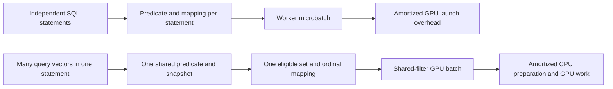
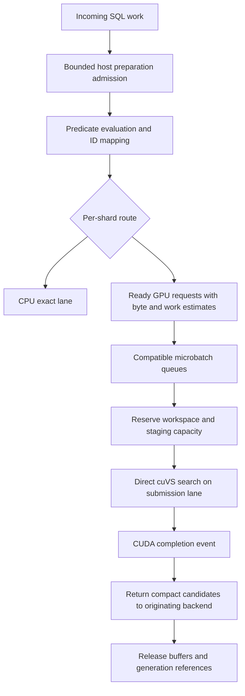

# cuVS filtered-search throughput analysis

Status: proposed optimization design and experiment plan; no throughput measurements have been collected for this implementation.

Prepared: 2026-10-30. Release-specific observations refer to cuVS v26.10.00. This document extends the [overall implementation plan](cuvs-filtered-ann-plan.md), including its PostgreSQL architecture, snapshot, and result contracts.

## 1. Two optimization tracks

Optimize the complete SQL request at a fixed filtered-recall and tail-latency target. GPU kernel QPS alone does not establish application throughput.

| Track | Primary question | Options to evaluate |
| --- | --- | --- |
| A: text eligibility and ID preparation | Can PostgreSQL supply correct eligible IDs fast enough? | Better predicate child plans, compact/page-local mapping, bounded materialization, and same-statement shared-filter batches. |
| B: vector execution and GPU utilization | Can the worker process those IDs efficiently under concurrent load? | CPU/GPU exact subset search, filtered CAGRA, compatible microbatches, resident data, and a small number of asynchronous submission lanes. |

These tracks complement each other. Cross-backend GPU batching does not remove repeated GIN scans, heap rechecks, or ordinal conversion. Conversely, faster eligibility does not help once the worker is saturated.

The two vector execution options are **exact search over matching rows** and **filtered ANN over a larger index**. Route per shard using measured costs. Do not force highly selective queries through CAGRA merely because the table is large.

## 2. Capacity and latency model

Distinguish **completed SQL statements/second** from **completed vector searches/second**. For a fixed B query vectors per successful statement, vector-search rate equals B times statement rate. Report B, full statement latency, and per-vector recall. Otherwise the shared-filter batch experiment can appear to improve QPS merely by changing what is counted.

For one SQL statement, measure the following elapsed-time components. Overlapping work must be identified rather than counted twice:

```text
Tsql = parse/plan + predicate evaluation + identity mapping + filter encoding
       + queue/batch wait + transfers + vector search
       + delta search + visibility recheck + reranking/projection + response
```

Normalize CPU and transfer demand per logical vector search, amortizing shared statement work over its B vectors. For a fixed workload mix:

```text
CPU vector-rate ceiling  = available CPU cores / CPU-seconds per vector search
Link vector-rate ceiling = effective bytes per second / bytes per vector search
Serial GPU batch rate    = completed query rows per batch / batch service seconds
Measured GPU vector rate = total completed query rows / elapsed measurement window
                           across all active submission lanes
SQL statement rate       = completed vector-search rate / B  (fixed B)
```

The CPU/link ceilings are diagnostic bounds, not predictions. The serial batch rate is a baseline, not an upper bound when batches overlap. Estimate sustainable GPU capacity from load curves across all lanes; the slowest resource constrains the overall vector rate. Shared cores, cache contention, variable filters, and retries change service demand. Adding isolated benchmark rates is invalid.

Report both successful statement and vector-search rates at an agreed recall and statement-p99 latency target. Also report offered rates, timeouts, rejected requests, errors, and late completions. Never improve the headline by dropping slow requests from the denominator or lowering recall without reporting it.

Use Little's law only as an average consistency check: mean in-flight statements equal statement arrival rate times mean statement residence time for a stable system. For example, 10,000 statements/second at 20 ms mean residence implies 200 mean in-flight statements. This does not define a safe queue cap or a p99 bound.

### Worked byte-budget example

Assume 10 million FP32 vectors, dimension 768, and independent query-specific filters. The following is arithmetic, not measured hardware performance:

| Eligible count M | Survivor fraction | Matching vector content | Content rate at 1,000 vector searches/s |
| --- | --- | --- | --- |
| 1,000 | 0.01% | 3.072 MB | 3.072 GB/s |
| 10,000 | 0.1% | 30.72 MB | 30.72 GB/s |
| 100,000 | 1% | 307.2 MB | 307.2 GB/s |

If the vectors are already resident, these bytes are device-side reads rather than host uploads. A gather may also write a compacted matrix and search may read it again. If each query uploads its eligible vectors from PostgreSQL, the host/device link must carry this traffic too. Residency can therefore change the winning route.

At M = 10,000, the 32-bit eligible ID array is only 40 KB, the query vector is 3,072 bytes, and a full 10-million-row bitset is 1.25 MB. Keep vectors resident and compare sparse-ID transport with dense masks before optimizing small result messages. Include ID conversion and encoding time in that comparison.

## 3. Track A: reduce the PostgreSQL producer cost

### Establish the CPU ceiling first

Add a diagnostic worker mode that accepts requests and returns without vector computation. It is a benchmark fixture, never a query path that claims valid search results. This isolates predicate execution, visibility checks, HOT resolution, ordinal lookup, encoding, and IPC.

Record at least three different cardinalities:

- `F`: raw predicate/index candidates requiring evaluation or recheck.
- `H`: heap pages visited during eligibility evaluation.
- `M`: eligible searchable vectors after all required checks.

A tiny M can follow a large F and H. For example, a rare tenant combined with common text terms may still read substantial postings and heap data. Benchmark B-tree-first, GIN-first, bitmap-intersection, and ordinary sequential child plans. Do not force GIN simply because a full-text predicate is present.

Use `EXPLAIN (ANALYZE, BUFFERS)` on representative child queries and collect lossy/exact heap blocks, recheck removals, buffer reads, and I/O timing when enabled. Test generic and custom prepared plans with skewed tenant/query parameters; runtime vector routing cannot repair a poor predicate child plan.

### Preserve complete eligibility

Require `gin_fuzzy_search_limit = 0` when a GIN path supplies an exact allowlist. A nonzero setting can omit matches; such a result is neither exact nor a conservative superset. Reject that configuration for this path or choose a complete eligibility plan. Under writes, measure GIN pending-list size and cleanup activity because queries also search pending entries. [PostgreSQL GIN behavior](https://www.postgresql.org/docs/current/gin.html)

Measure phrase/weight rechecks and lossy bitmaps separately from simple terms. Sweep `work_mem`, but do not treat it as a cap on extension-owned allocations. Concurrent executor operations and sessions multiply memory demand; custom ID arrays and caches need explicit accounting. [PostgreSQL resource settings](https://www.postgresql.org/docs/current/runtime-config-resource.html)

### Make mapping compact and local

1. Return only identity and required mapping fields from the child plan; defer vector detoasting and full result projection.
2. Append IDs to bounded contiguous arrays, not one PostgreSQL `List` node or allocation per match.
3. Resolve HOT roots and ordinal mappings in page-local groups where possible, releasing buffer content locks before any GPU/IPC wait.
4. Benchmark bounded per-backend lookup caches against a shared immutable generation map. Do not duplicate an N-entry reverse map in every backend.
5. Account for mapping-cache bytes, cache misses, spilled materialization, and cold versus warm lookup behavior.
6. Deduplicate and translate to shard-local ordinals before claiming a sorted local-ID representation. Heap-TID order need not preserve ordinal order.

### Two kinds of batching have different benefits



Prototype an explicit batch-search entry point for multiple query vectors sharing one predicate, security context, and statement snapshot. Restrict the reusable predicate to the supported nonvolatile shape and preserve each query's own top-k result. This can reuse eligibility, mapping, a device allowlist, and an exact gathered subset.

Do not silently combine independent SQL snapshots. Read Committed statements can see different committed rows, and transactions can see their own writes. Even repeatable snapshots need command/own-write awareness. Statement-scoped eligible-set reuse is the initial optimization. [PostgreSQL transaction isolation](https://www.postgresql.org/docs/current/transaction-iso.html)

The vector generation being immutable does not make text metadata immutable: a HOT update may change text while leaving the vector unchanged. A cache keyed only by vector generation and predicate text is unsafe. Cross-statement predicate caches require their own proven invalidation and snapshot model. Identical already-validated allowlist contents may share a device allocation while each backend retains responsibility for its query's visibility.

## 4. Track B: choose exact or ANN execution by measured work

### Exact subset search

For tiny M, CPU exact search can avoid queueing and GPU launch costs. Compare it with the ordinary PostgreSQL filter-then-exact plan, which may already have the relevant heap tuple and avoid a second canonical-vector gather.

For larger selective sets, evaluate two GPU implementations:

- Explicit sparse-ID gather followed by exact search over the compacted vectors.
- The library's filtered brute-force path over resident full vectors.

Released cuVS can internally select sparse masked multiplication, gather-and-search, or dense distance evaluation followed by masking. Shared bitsets can use one common gathered subset; heterogeneous per-query bitmaps cannot use that same common-gather branch. Therefore a filtered API call does not guarantee distance work proportional to M. Record which path executes and measure setup costs. [Released exact-search implementation](https://github.com/NVIDIA/cuvs/blob/v26.10.00/cpp/src/neighbors/detail/knn_brute_force.cuh)

For B queries sharing an identical eligible set, gather once and reuse the subset. A dot-product formulation has approximately `2 * B * M * D` multiply/add work, excluding norms and top-k selection. Vector reuse can improve arithmetic intensity, but top-k and scratch space still matter. Tile computation so the service does not require an unbounded B-by-M distance matrix.

For distinct filters, benchmark independent compacted subsets against masked execution. A union of eligible sets requires per-query masking and can become much larger than each original set; it is not automatically a better batch.

### Filtered CAGRA

Measure candidate capacity and visited-state workspace after cuVS's filter adjustment, not just requested k and input bytes. In the released MULTI_CTA implementation, for survivor fraction s and initial capacity I, the adjustment is approximately:

```text
adjusted capacity = round_up_to_32(k / s + (I - k) / sqrt(s))
```

With k = 20, I = 64, and s = 0.001, this is approximately 21,408 intermediate candidates. It is an internal capacity, not a visited-row count or a recall guarantee. It explains why highly selective queries can become expensive ANN jobs despite small output. [Released search-plan adjustment](https://github.com/NVIDIA/cuvs/blob/v26.10.00/cpp/src/neighbors/detail/cagra/search_plan.cuh)

Start with automatic kernel selection, then compare supported SINGLE_CTA and MULTI_CTA settings at equal recall. Sweep `itopk_size`, `search_width`, candidate count, and batch size together; reserve explicit workspace headroom. Keep `max_queries` bounded rather than treating its automatic value as a service admission policy. Parameter validity and algorithm constraints come from the [released search API](https://github.com/NVIDIA/cuvs/blob/v26.10.00/cpp/include/cuvs/neighbors/cagra.hpp).

Use measured route tables indexed by M, dimension, residency, k/candidate budget, batch type, and current queue load. Add hysteresis so small estimate changes do not continually switch routes. Recalibrate when the index generation, hardware, or workload distribution changes. Sending work to a saturated CPU fallback is not a free overload remedy.

Filling k results is separate from matching the recall target. Tune and compare complete pipelines, including reranking and retries. A CAGRA retry is another search request; charge its work and deduplicate accumulated candidates before final sorting.

## 5. Microbatching and admission control



### Compatibility rules

Group by generation, shard/local-ID domain, metric, dtype/layout, route, search-parameter profile, candidate-budget class, and selectivity class. Shared-bitset batches additionally require the same allowlist. Direct C++ Roaring batches retain each query's own allowlist and result mapping.

Remove empty requests before dispatch. Separate extremely selective ANN requests from broad ones: Roaring's automatic filtering estimate uses the most selective query in the batch. Reuse device allowlist owners only while their validity and lifetime are established. The sorted-ID construction shortcut requires strictly increasing, unique, in-range local IDs. [Filter contract](https://github.com/NVIDIA/cuvs/blob/v26.10.00/cpp/include/cuvs/neighbors/common.hpp), [Roaring construction contract](https://github.com/NVIDIA/cuvs/blob/v26.10.00/cpp/include/cuvs/core/roaring_allowlist.hpp)

Avoid overfragmenting queues into one bucket per tenant or exact k unless required for correctness. Compatible requests can use a common larger candidate budget and truncate per query, but only when the extra work and recall behavior are acceptable. Age-based dispatch must prevent rare buckets from waiting indefinitely.

### Dispatch and memory bounds

Dispatch at the earliest of a row cap, a workspace/work cap, or the oldest request's permitted batch delay. Use each request's remaining deadline and reserve time for result transfer and PostgreSQL completion. Batch-formation delay is only one part of end-to-end latency.

Start experiments with batch rows `1, 4, 16, 64, 128, 256`, batch-delay budgets `0, 25, 50, 100, 250, 500` microseconds, and `1, 2, 4` submission lanes. These are a search grid, not recommended defaults. Prune unsupported combinations and reserve workspace before launch.

Bound both producer memory and worker memory. A bounded GPU queue does not stop many PostgreSQL backends from allocating large ID sets simultaneously. Reserve host preparation capacity before large materialization, then GPU workspace only after a request is ready. Specify spill, alternate-plan, or explicit error behavior without violating the query contract.

Track queued bytes and estimated service work as well as request count. A 1,000-ID query and a million-ID query must not consume indistinguishable admission units. Preserve per-tenant fairness and cap retry work; long queues retain snapshots and generations and can delay vacuum/compaction.

### Why not use the cuVS batch wrapper by default?

The released dynamic-batching wrapper fixes k, upstream parameters, and its optional shared filter at construction. It rejects Roaring, and its dispatch timeout does not bound complete request latency. It can suit stable same-filter or unfiltered traffic; use application-controlled direct calls for heterogeneous text filters. [Released dynamic-batching API](https://github.com/NVIDIA/cuvs/blob/v26.10.00/cpp/include/cuvs/neighbors/dynamic_batching.hpp)

## 6. Residency, asynchronous execution, and persistent search

Keep active graphs and vector data resident within the declared capacity envelope. Pool pinned host staging, query/result buffers, allowlists, and workspace rather than allocating them on every request. Pinned-memory budgets must be bounded; using more pinned memory is not an unlimited optimization.

Use one reusable resources object per submission thread/lane, or serialize its use. cuVS resources are not concurrently thread-safe. Chain preparation, search, and result transfer on streams with explicit dependencies; wait when results or resource reclamation require completion. Different streams permit overlap but do not guarantee it. [cuVS resource ownership](https://docs.nvidia.com/cuvs/user-guide/api-guides/core-types/resources)

Try preparing batch n+1 while batch n executes and batch n-1 completes. Measure whether memory bandwidth or workspace contention cancels the benefit. Avoid device-wide synchronization in the request loop and PostgreSQL buffer locks across any worker wait. CUDA's guidance emphasizes reducing transfers and using appropriate pinned/asynchronous transfers for overlap. [CUDA best practices](https://docs.nvidia.com/cuda/cuda-c-best-practices-guide/index.html)

Canceled requests may already have GPU work in flight. Discard their results while retaining referenced buffers and generations until completion. Cancellation tests must cover allocation reuse and index eviction, not only client-visible timeout latency.

Treat persistent CAGRA as a separate experiment for stable repeated workloads. The API restricts it to SINGLE_CTA and documents progress hazards with concurrent work, allocation, and pageable transfers. Keep it disabled for the initial mixed exact/ANN service. [Persistent search contract](https://github.com/NVIDIA/cuvs/blob/v26.10.00/cpp/include/cuvs/neighbors/cagra.hpp)

Persistent filtering is not universally unsupported. However, the released runner's reuse depends on graph, parameters, and filter payload identity. Fresh allowlists or alternating shards can defeat reuse. Measure runner churn before treating persistence as a throughput improvement. [Released persistent launcher](https://github.com/NVIDIA/cuvs/blob/v26.10.00/cpp/src/neighbors/detail/cagra/search_single_cta_kernel_launcher_jit.cuh)

## 7. Shards, delta, and result production

### Shards and replicas

Prune only shards proven irrelevant by partition metadata or an empty eligible intersection. Every remaining shard adds search work and candidates. With S shards returning r candidates each, transport and reranking scale with approximately S times r, even when every local kernel is fast.

Compare fewer large shards with many small shards at the same memory limit and recall. Batch compatible work per shard in the worker; avoid a backend RPC per row. Use exact local top-k when its eligible subset is small and ANN for other shards, then merge comparable distances.

When a full index fits each GPU, replicas may improve throughput by assigning complete requests to different devices. Sharding primarily solves capacity and can add fanout and merge costs. Benchmark both layouts when feasible; neither fixes a CPU eligibility bottleneck.

### Delta and compaction

Map eligible new/updated entries directly into the relevant delta segments. Avoid a full mutable-delta scan for every query. Measure cost versus delta cardinality, segment count, write rate, and time since compaction.

Trigger compaction decisions using observed query cost and memory pressure as well as entry count. Bound build resources so compaction does not consume serving workspace or cause repeated cache eviction. Preserve the overall plan's base/delta coverage and old-snapshot rules; performance shortcuts cannot hide fresh writes or discard still-visible versions.

### Heap fetch and reranking

Keep worker results to compact identities and distances. Delay full row projection until after candidate selection. Deduplicate version identities, perform required visibility/qualification checks, and use bounded top-k selection rather than sorting an unnecessarily large candidate union.

Count original-vector reads and detoasting during authoritative reranking. Reranking every shard's excessive oversampling can shift the bottleneck back to the backend. Measure candidate count, duplicate rate, recheck failures, vector bytes, heap fetches, and refill rate together.

## 8. Experiment sequence and acceptance gates

Run these in order so optimization effort follows measured bottlenecks:

| Experiment | Controlled comparison | Decision it enables |
| --- | --- | --- |
| E1: producer ceiling | Complete eligibility/mapping with diagnostic no-compute worker, at increasing client concurrency. | Whether Track A limits target QPS before GPU tuning. |
| E2: mapping layout | Narrow contiguous IDs, page grouping, bounded caches; cold/warm HOT and ordinal lookup. | Mapping design and host memory budget. |
| E3: safe reuse | Independent statements versus many query vectors under one statement/predicate/snapshot; report both statement and vector-search rates. | Value of an explicit shared-filter batch API. |
| E4: exact crossover | Native PostgreSQL exact, adapter CPU exact, GPU gathered exact, and library filtered brute force. | Route thresholds by M, dimension, residency, and batch type. |
| E5: filtered CAGRA | Candidate/iteration/search-width profiles and kernel modes, at equal filtered recall. | ANN cost and workspace profiles. |
| E6: filter transport | Dense masks, sparse IDs, Roaring; first-use and reused buffers; shared and unique filters. | Representation and cache policy. |
| E7: batching | Batch rows, formation delay, lanes, mixed selectivity, and skewed tenants. | Dispatch limits and fairness settings. |
| E8: offered load | Arrival-rate sweep through saturation with all waits/rejections recorded. | Sustainable statement/vector rates at p99/recall objectives. |
| E9: write interference | GIN pending entries, delta growth, long snapshots, and compaction during queries. | Maintenance limits and retention budget. |
| E10: fanout | Shard count, skew, pruning, replicas, and rerank budgets. | Capacity layout and multi-GPU strategy. |
| E11: persistent mode | Stable shared filters versus fresh per-query filters and alternating shards. | Whether persistence earns its complexity. |
| E12: cold/failure behavior | First load/JIT, filter creation, cache eviction, worker restart, and cancellation. | Warmup policy and bounded degradation. |

Use survivor fractions from 100% to 0.001%, plus empty and fewer-than-k cases. Include text/vector correlation and anti-correlation, common-word/rare-tenant combinations, phrase queries, and varied k. Test target dimensions and some non-aligned dimensions to expose layout-dependent batching behavior. Record full dataset, filter, hardware, version, and parameter manifests.

Use closed-loop clients for concurrency sweeps and open-loop scheduled arrivals to expose overload. Measure from intended arrival to completion as well as server receipt to completion; otherwise a blocked generator can hide queueing. Report offered/accepted/completed rates and preserve timeout/error samples. Run sufficiently long to observe maintenance effects and report variation across repeated runs.

Compute exact ground truth among qualifying visible rows for frozen snapshots or controlled fixtures. For mutable tests, do not compare against a later snapshot and label the difference a recall error. Use tie-aware recall and compare configurations only at the same quality target. The cuVS benchmark methodology also emphasizes recall/throughput comparisons. [cuVS methodology](https://docs.nvidia.com/cuvs/user-guide/benchmarking-guide/methodologies)

### Instrumentation

Record per-request timestamps and a request ID across the backend/worker boundary. Within a host, use consistent monotonic elapsed timing; measure GPU intervals with CUDA events and complete them before reading elapsed values.

| Layer | Required observations |
| --- | --- |
| Predicate | F, H, M, plan shape, rechecks, buffers, I/O, pending-list effects. |
| Mapping | HOT resolution, lookup misses, allocated/spilled bytes, sorted/deduplicated IDs. |
| Admission | Host and device reserved bytes, queue age, rejects, deadline remaining. |
| Batch | Actual/maximum rows, route, selectivity distribution, shared-filter ratio. |
| GPU | Chosen algorithm, adjusted budgets, workspace, transfers, allocation counts, device time. |
| Completion | Base/delta/shard candidate counts, rerank bytes/time, heap fetches, refills. |
| Service | Successful/late/error statement and vector rates, vectors/statement, statement p50/p95/p99, CPU/GPU utilization, retained generations. |

Use system profiling to locate idle gaps, copy/compute serialization, allocator stalls, and host submission delays. Use kernel profiling for memory throughput, cache behavior, occupancy, and top-k costs. Rerun final throughput outside profiling because profiling can serialize work and alter cache behavior. [Nsight Compute profiling guide](https://docs.nvidia.com/nsight-compute/ProfilingGuide/)

## 9. Changes to the implementation sequence

- Phase 0: define quality/latency targets and add producer-only plus native PostgreSQL exact baselines.
- Phase 1: implement reusable buffers, explicit batch/workspace caps, route telemetry, and direct-search microbatching before persistent mode.
- Phase 2: benchmark statement-scoped shared-filter batches, host admission, compact mapping, and complete SQL throughput.
- Phase 3: cost eligibility startup and spill; preserve independent AM and CustomScan state; expose timings and route decisions through diagnostics/EXPLAIN.
- Phase 4: test pending-list, delta, snapshot-retention, and compaction interference at sustained offered load.
- Phase 5: choose shard/replica layout and persistent search only after their end-to-end gains survive equal-recall and p99 comparisons.

Do not accept an optimization on kernel QPS alone. Require unchanged row/predicate correctness, the agreed filtered recall, bounded host/device memory, and improved successful throughput at the latency target. Until hardware and workload targets are supplied, these experiments define the work; they do not imply a promised QPS.
